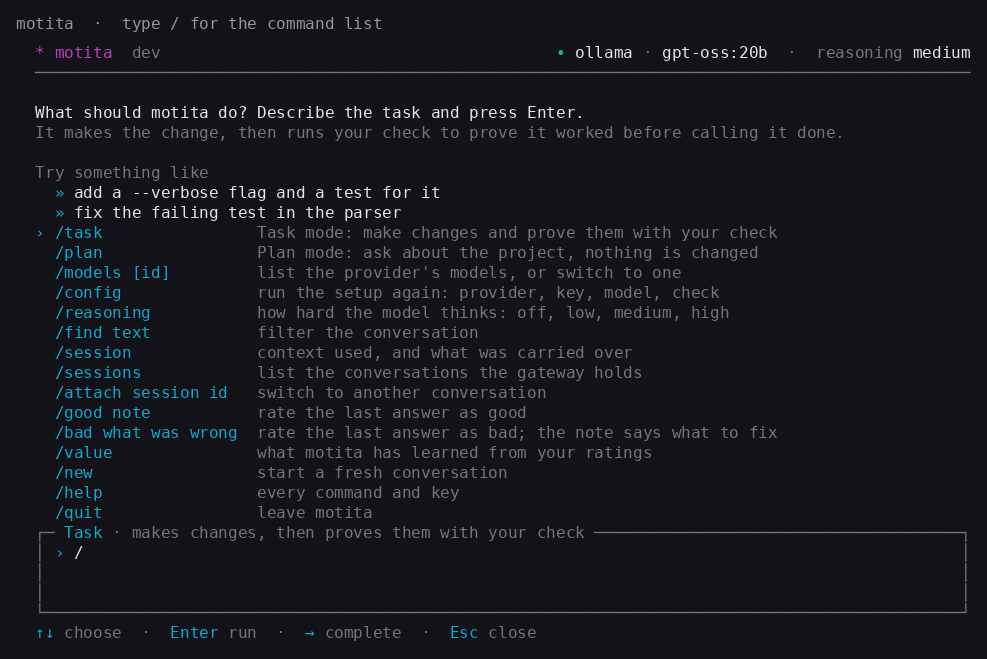
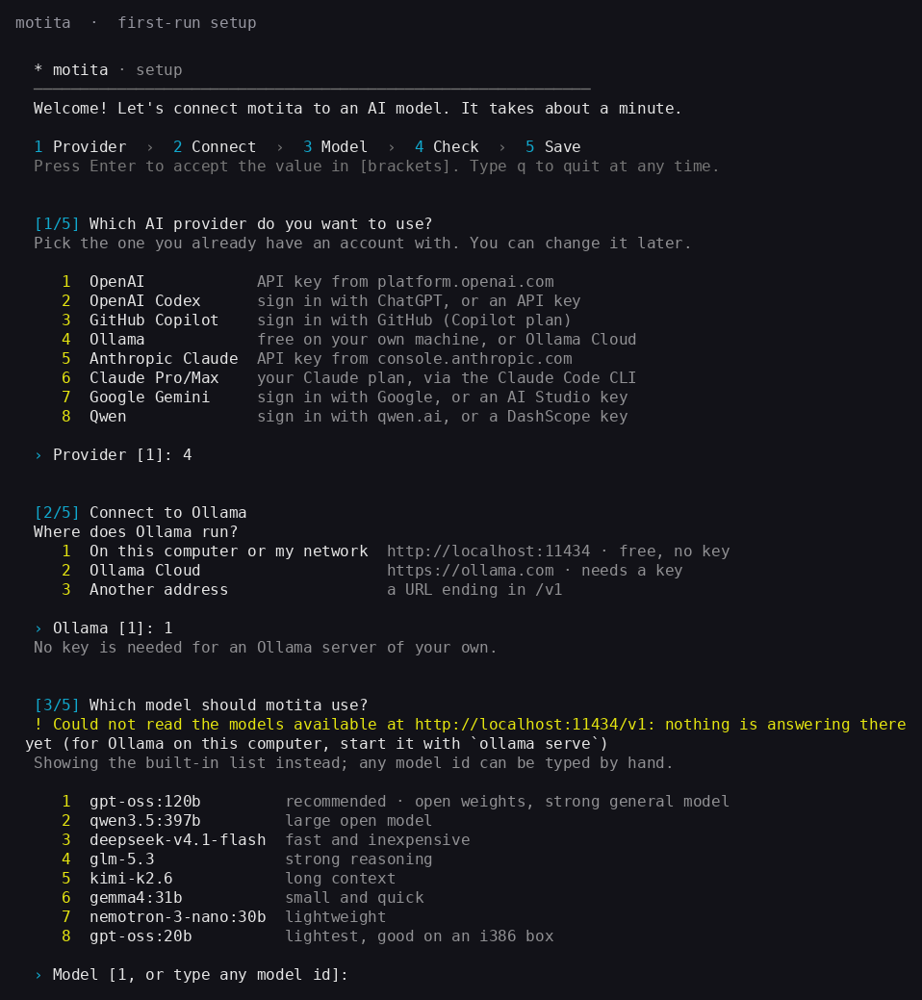
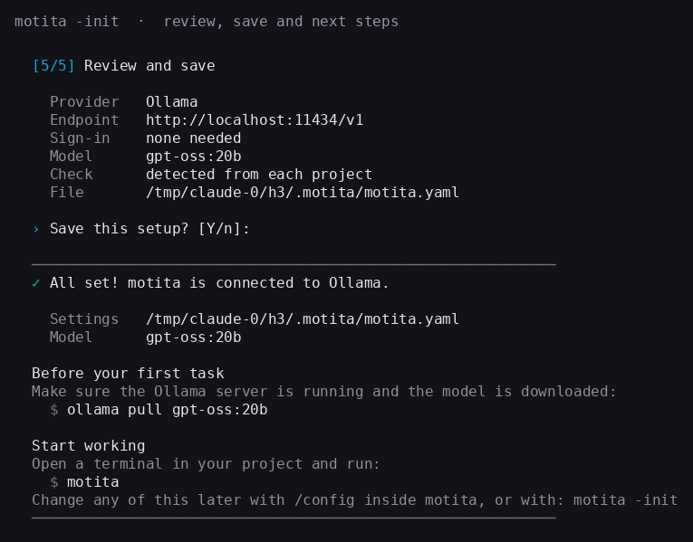
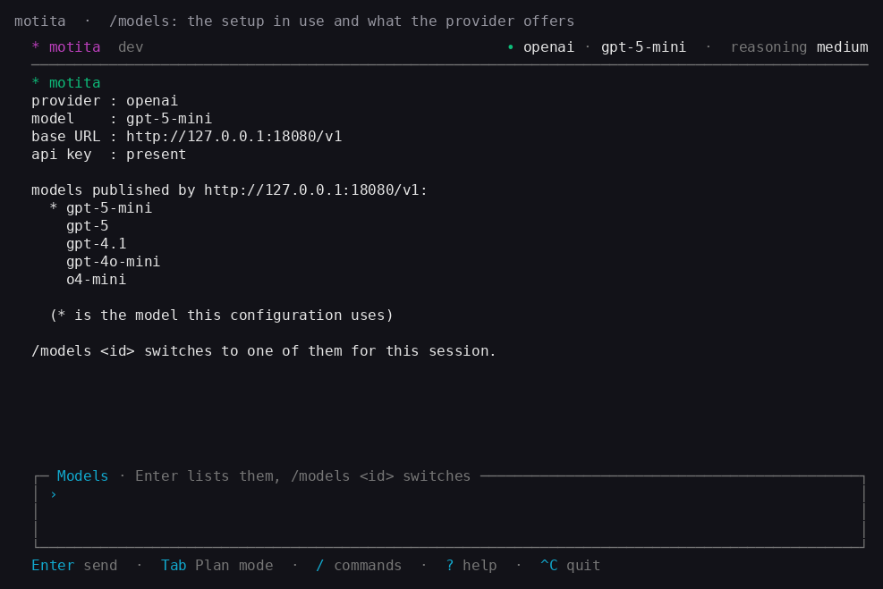
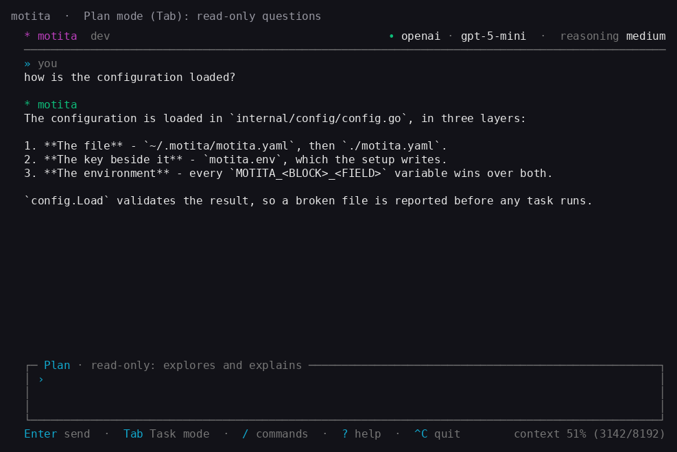

# motita 🌟

A **3-layer** autonomous agent for i386 machines (and any Linux amd64/arm64),
written in **pure Go**: standard library only, **zero external dependencies**,
no cgo and **no Docker**.

The principle that governs it: **the model proposes, a deterministic validator
disposes**. No task is ever considered complete because the LLM says so; only the
anchor can declare `PASS`, and it does that by running real checks.

```
TASK ──► [Layer B] analyse ─► plan ─► propose an action
                                            │
                            [Layer C] run it isolated
                                            │
                            [Layer A] validate (PASS/FAIL)
                                            │
               PASS ──► final action (commit / publish / notify)
               FAIL ──► failure records back to the LLM, retry
            exhausted ──► escalate
```

Running the binary with no arguments starts an **interactive text user
interface (TUI)**: a conversation with the agent in **Task** mode (it changes files
and proves the change with your check) or read-only **Plan** mode (`Tab` switches),
with `/` opening the command list — the setup (`/config`), the models your provider
publishes (`/models`), the git hosts (`/git`: connect GitHub, GitLab or Bitbucket, or a
self-hosted `gitlab:git.example.com`, by browser login or a token; `/git repos` lists what you can
reach), the sessions the gateway holds, and help (`?`). Task mode and
plan mode are both driven by the same 3-layer agent.



---

## Architecture

### Layer A — THE ANCHOR (deterministic validator)

A native component that **always** validates the result, with no reasoning:

|         |                                                                                                    |
| ------- | -------------------------------------------------------------------------------------------------- |
| Input   | the state of the system after the agent's action                                                   |
| Process | strict validations: commands, exit codes, regular expressions over the output, business invariants |
| Output  | `PASS`/`FAIL` plus structured JSON records                                                         |
| Traits  | no LLM, fast and predictable, rules configurable from the YAML                                     |

Design rules the code actually enforces:

- **No validator, no success.** With `anchor.kind=none` the anchor returns `FAIL`
  and the agent **refuses to start**, because there is no authority that can
  declare `PASS`. A `PASS` with no real check is exactly the failure this
  architecture exists to prevent.
- **`anchor.kind=auto` reads the gate the PROJECT declares**, in the directory the
  agent is working in, so one configuration works across projects: `check`/`test`
  from a Makefile, `go test ./...` from a `go.mod`, the `lint`/`typecheck`/`test`
  scripts from a `package.json`, `cargo test`, `pytest`. A project with an unusual
  build names its own gate in `.motita/anchor` (one command per line, `#` comments),
  and that wins over every convention. Detection only READS, so it is idempotent.
  With no gate found the anchor returns `FAIL` and names what it looked for.
- **Every check must pass.** A single failing `check` invalidates the whole
  result.
- **An anchor that cannot be evaluated is a failure, not a silent success**: if
  the command does not exist, times out, or the regular expression does not
  compile, it returns `FAIL` with the reason.
- **The anchor's output is JSON** and it travels whole to the LLM on the next
  attempt, together with the real output of the failed command.

### Layer B — THE REASONING ENGINE (lightweight LLM client)

A hand-written client (no SDK) for three API families: **OpenAI-compatible**
(`/chat/completions`), **Anthropic** (`/v1/messages`) and **Gemini**
(`:generateContent`). The OpenAI-compatible implementation accepts any `base_url`,
so it works with OpenAI, Ollama Cloud, Groq, OpenRouter, DeepSeek, and similar
hosts. All providers are normalised to the same message structure, so the rest of
the agent does not know which one is behind it. A key is never sent in clear text:
a plain `http://` `base_url` is refused when `api_key` is set unless it points at
this machine or a private network address.

- Reads the context: task, plan, attempt number and **the records of previous
  failures**.
- Dynamic prompts built from templates with `{{...}}` variables, 100%
  configurable: the engine never writes prompt text on its own.
- **Retries with exponential backoff**, with a distinction that matters: `429`,
  `5xx` and network errors are retried; `401`/`400` are **not**, because retrying
  an invalid credential only burns time and quota.
- Structured-response parsing tolerant of what models really return: ` ```json `
  blocks, surrounding prose, nested braces, escaped quotes, truncated answers.
- **At most N attempts** before escalating.

### Layer C — THE SANDBOX (light isolation, no Docker)

Layered isolation, applying whatever the system allows and **telling the truth
about what could not be applied**:

| Layer                    | What it does                                                                                              | Requirements                                                                                                  |
| ------------------------ | --------------------------------------------------------------------------------------------------------- | ------------------------------------------------------------------------------------------------------------- |
| Ephemeral temp directory | its own `TMPDIR` per attempt, deleted at the end                                                          | none                                                                                                          |
| `ulimit` limits          | CPU, memory (address space), processes, file descriptors, max file size                                   | none                                                                                                          |
| cgroups v1               | a real cap on memory and PIDs (`RLIMIT_AS` is only an approximation)                                      | kernel with cgroups v1 and write permission                                                                   |
| cgroup v2 per run        | every process a command started is killed when it ends, one that left the process group with `setsid` too | a writable cgroup v2 tree (root, or a delegated user slice) and `clone3`; without it, the process group alone |
| chroot + privilege drop  | restricted filesystem root and an unprivileged user                                                       | being root                                                                                                    |
| `CLONE_NEWNET`           | no network inside the command                                                                             | `CAP_SYS_ADMIN`                                                                                               |

Details that took real work and are solved in the code:

- **The limits are applied by the shell, not by the agent.** A child process
  which is the binary re-executed (marker `__sandbox_exec`) prepares the ground
  (`chroot`, `chdir`, dropping privileges, resolving the command path) and then
  `syscall.Exec`s `sh -c 'ulimit ...; exec "$@"'`. This is a measured decision,
  not an aesthetic one:
  - a Go binary **cannot** apply `RLIMIT_AS` and stay alive: the limit also
    counts the virtual memory the runtime maps, so the next allocation (sysmon,
    GC, even resolving `PATH`) kills it with `fatal error: runtime: cannot
allocate memory`. It only showed up on a CI runner with more cores; on a
    small machine it did not appear.
  - `RLIMIT_CPU` does not cut at the exact instant, only at the next scheduling
    of the process. Measured on a single-core machine: with `RLIMIT_CPU` alone
    and no memory limit, an infinite loop with `cpu_seconds: 2` was still alive
    after **12 s** (the limit was never applied because the runtime allocated
    memory in between).
  - with `sh -c 'ulimit …; exec "$@"'` the limited process is exactly the user's,
    the shell disappears with the `exec` (no intermediate process is left behind)
    and neither `prlimit`, nor util-linux, nor privileges are needed.
  - verified: an infinite loop with `cpu_seconds: 2` is cut at **1.994 s**;
    `ulimit -n` inside the command returns the configured value.
- **A `memory_mb` below what the launcher already uses is raised, with a
  warning.** On the target machines (i386 with little RAM) the value is small,
  but it cannot sit below the already-mapped address space: the command would not
  even start. The adjustment is dynamic (real peak ×2), not a constant, and it is
  logged.
- **`syscall.Exec` does not search `PATH`**: a `command: make` written in the
  YAML would fail with `ENOENT`. The child resolves the path using the sandbox's
  **restricted `PATH`**, not the agent's.
- **The working directory is persistent; the temporary one is ephemeral.** The
  effect of the work must survive so the anchor can see it. If the actions ran in
  a directory deleted at the end, the validator would never find the result and
  the agent would fail every time (this really happened during development and is
  covered by a test).
- **Kill the process group, not just the child.** `exec.CommandContext` kills
  `sh`, but its descendants stay alive holding the output pipe open and `Wait`
  keeps waiting: measured, a `sleep 30` with a 1 s deadline took **5 s** to
  return. With its own process group plus `SIGKILL` to the group it cuts at the
  exact deadline (measured: infinite loop with `cpu_seconds: 2` → cut at
  **2.002 s**).
  A process that called `setsid` leaves that group: where motita can make a cgroup v2
  group, each run's child starts inside one (`CLONE_INTO_CGROUP`) and `cgroup.kill`
  ends whatever is left in it when the run ends.
- **The command does not inherit the agent's secrets**: the environment is built
  from scratch, with no `OPENAI_API_KEY` or `MOTITA_LLM_API_KEY` inside the
  command.
- **What a command prints is sent to the model provider.** Its output goes into
  the next prompt and into the transcript, so motita masks the secrets it
  recognises first (`Authorization` headers, `sk-…`, `ghp_…`/`github_pat_…`,
  `AKIA…`, `AIza…`, `xox?-…`, private key blocks, `user:password@` in URLs,
  `token=`/`key=`/`secret=`/`password=` parameters and `.env` lines, JSON fields
  such as `"access_token"` or `"client_secret"`) as `[REDACTED]`. It is a
  pattern scrubber, not a guarantee: a secret of another shape still reaches
  the provider, so keep real credentials out of the workspace.

---

## Agent flow

```
START
[1] READ TASK     from the configurable source (stdin, file, queue, API)
[2] EXTRACT       context and success criteria (the anchor's rules)
[3] LLM           analyses the task   -> {"understandable", "success_criteria", ...}
[4] LLM           produces a plan     -> {"plan", "subtasks", ...}
[5] SPLIT          into subtasks when the plan declares them (bounded depth); independent
                   ones run side by side in worktrees of their own and are merged in order
[6] LLM           produces the action -> {"actions", "final_action", "done"}
[7] RUN            in the SANDBOX (Layer C)
[8] VALIDATE       with the ANCHOR (Layer A) — always, even if [7] failed
    FAIL  -> failure records to the LLM, back to [6] while rejected rounds <= MAX_RETRIES
    PASS and "done": false -> the round's work is recorded, back to [6] for the NEXT batch
    PASS and "done": true  -> [9]
[9] PASS  -> run the final action (command | api | git_commit) and END
    rounds exhausted -> escalate (agent.on_failure) and END
```

Each entry of `actions` has a `kind`. `command` runs a shell line in the sandbox;
`write_file` (path on the first line of `command`, the whole content after it) and
`edit_file` (path, then one `<<<<<<< SEARCH` / `=======` / `>>>>>>> REPLACE` block whose
search text must occur exactly once) write files directly, without a shell, so source with
tabs and quotes needs no escaping. Both stay inside the working directory and are refused in
read-only mode. The procedure-library kinds (`list_skills`, `search_skills`, `read_skill`,
`save_skill`) are described in the execute prompt.

When the anchor refuses a claim of done and `anchor.baseline` is on, the failing checks are run
once more on a clean checkout of the tree the run started from. A check that failed there too
is reported as **already failing before this change**: when that is true of every failing
check the claim passes, and the verdict names those checks; a check that passed there is a
breakage the run caused, and the rejection says so. Only the project's own gate
(`anchor.kind: auto`) is compared this way: a check written into the configuration usually
states what the task must achieve, fails before the run by design, and is never excused.

**The loop has TWO bounds, because they answer two different questions.**

- `agent.max_retries` bounds **rejected** rounds: a validation the anchor refused, which
  the model corrects from the failure records it is handed.
- `agent.max_steps` (default 100) bounds **rounds altogether**. A request is usually a
  plan and not a single step, and the model reports whether it is finished through the
  `done` field of its action. With `"done": false` the round is not a failure — it is
  work — so it does not spend the retry budget, and the loop continues with everything
  already run in front of the model.

Without the second bound the anchor decided when to stop, and the anchor validates the
state of the PROJECT: on a healthy repository it passes before any work has happened.
Measured on a real run: a plan of eleven steps, one batch of four actions, and
`task completed` in twelve seconds with the other ten steps untouched.

A run that uses all its rounds with the model still reporting work left fails with a
message that says so — "the task is not finished: N rounds were used and the model still
reports work left" — and never declares PASS.

If the analysis declares the task **not understandable** (information missing),
nothing runs: the task is discarded with the reason and counts as a failure for
the exit code.

---

## Installation

**One line.** It detects the system, downloads the matching static binary from
the latest release, verifies it against the release's `SHA256SUMS`, and puts it
on your `PATH`. No Go, no Docker, no runtime on the target. It needs OpenSSL 3 to
check the release signature (see below):

```sh
curl -fsSL https://motita.kodingvibes.com/install.sh | sh
```

Override the version or the destination:

```sh
curl -fsSL .../install.sh | MOTITA_VERSION=v0.3.0 sh
curl -fsSL .../install.sh | MOTITA_INSTALL_DIR="$HOME/bin" sh
```

The installer prefers `/usr/local/bin` when it is writable and falls back to
`~/.local/bin` (`$PREFIX/bin` on Termux), so it never needs root. When that
directory is not on the `PATH`, it adds one marked `export` line to your shell's
startup file (`~/.bashrc`, `~/.zshrc`, fish's `conf.d`, or `~/.profile`), once,
so every new terminal finds `motita`; `MOTITA_NO_MODIFY_PATH=1` leaves the files
alone. A piped installer cannot change the shell you typed it into, so the
terminal you are in gets the `export` line to paste and the full path to run. It downloads into a temporary directory
and moves the binary into place **only after** the checksum matches: a failed or
corrupted download leaves the system as it was. Finally it runs the binary once,
because reporting success without executing it would miss the one failure that
matters — a binary that does not run on this machine.

`SHA256SUMS` comes from the same release as the binary, so on its own it catches
only a corrupted transfer. The installer also checks `SHA256SUMS.sig`, an ed25519
signature over `SHA256SUMS` made with the project's release key. The key is built
into the installers and the updater, so the signature is what refuses a compromised
release.

The signature check needs OpenSSL 3 (`openssl pkeyutl -rawin`). Most Linux
distributions ship it; on Termux run `pkg install openssl`. Stock macOS ships
LibreSSL, which cannot check it, so install OpenSSL 3 and put it first on the
`PATH` before the install line:

```sh
brew install openssl@3
export PATH="$(brew --prefix openssl@3)/bin:$PATH"
```

If OpenSSL 3 is missing, or the release has no `SHA256SUMS.sig`, the installer
stops and installs nothing. `MOTITA_INSECURE_SKIP_VERIFY=1` installs anyway,
without the check (not recommended). A checksum mismatch or a signature that does
not verify always stops the install.

**On Windows**, in PowerShell:

```powershell
irm https://motita.kodingvibes.com/install.ps1 | iex
```

It does the same four things as the shell installer — detect the architecture,
download the matching `.exe`, verify it against the release's `SHA256SUMS`, and
put it on your `PATH` — using what Windows has: `PROCESSOR_ARCHITEW6432` for the
architecture (a 32-bit PowerShell on 64-bit Windows reports `x86` and must be
corrected, or you silently get the 32-bit binary), `Get-FileHash` for the
digest, and the **user** `PATH` scope, so it never needs administrator rights.
Windows has no ed25519 verifier, so it checks `SHA256SUMS.sig` with OpenSSL 3: the
one on the `PATH`, or the one Git for Windows carries. Without one it stops, the
same as the shell installer. Install Git for Windows or run
`winget install ShiningLight.OpenSSL.Light`, or set
`$env:MOTITA_INSECURE_SKIP_VERIFY = '1'` to skip the check (not recommended).

It installs to `%LOCALAPPDATA%\Programs\motita\motita.exe` by default; override
with `$env:MOTITA_INSTALL_DIR`, and pin a release with `$env:MOTITA_VERSION`:

```powershell
$env:MOTITA_VERSION = 'v0.7.0'
irm https://motita.kodingvibes.com/install.ps1 | iex
```

On failure it **throws** instead of exiting, and that is deliberate: the script
is normally run through `irm ... | iex`, and `exit` inside `Invoke-Expression`
ends _your_ PowerShell session — a failed download would close the window. A
thrown error is printed, is catchable, and still gives exit status 1 when the
file is run directly.

**By hand**, if you prefer to see each step:

```bash
# Linux / 386 (32-bit x86, the primary target)
curl -fsSLO https://github.com/madkoding/motita/releases/latest/download/motita-linux-386 && chmod +x motita-linux-386 && ./motita-linux-386 -version

# Linux / amd64
curl -fsSLO https://github.com/madkoding/motita/releases/latest/download/motita-linux-amd64 && chmod +x motita-linux-amd64 && ./motita-linux-amd64 -version

# Linux / arm (ARMv7: Raspberry Pi 2 and newer)
curl -fsSLO https://github.com/madkoding/motita/releases/latest/download/motita-linux-arm && chmod +x motita-linux-arm && ./motita-linux-arm -version

# Linux / arm64
curl -fsSLO https://github.com/madkoding/motita/releases/latest/download/motita-linux-arm64 && chmod +x motita-linux-arm64 && ./motita-linux-arm64 -version

# macOS / Apple Silicon
curl -fsSLO https://github.com/madkoding/motita/releases/latest/download/motita-darwin-arm64 && chmod +x motita-darwin-arm64 && ./motita-darwin-arm64 -version

# macOS / Intel
curl -fsSLO https://github.com/madkoding/motita/releases/latest/download/motita-darwin-amd64 && chmod +x motita-darwin-amd64 && ./motita-darwin-amd64 -version

# Windows / amd64 (PowerShell)
curl -fsSLO https://github.com/madkoding/motita/releases/latest/download/motita-windows-amd64.exe; if ($?) { ./motita-windows-amd64.exe -version }
```

| System           | Architectures                    | Asset suffix          |
| ---------------- | -------------------------------- | --------------------- |
| Linux            | `386`, `amd64`, `arm`, `arm64`   | `-linux-<arch>`       |
| Android (Termux) | `arm64`                          | `-android-<arch>`     |
| Windows          | `386`, `amd64`, `arm64`          | `-windows-<arch>.exe` |
| macOS            | `amd64`, `arm64` (Apple silicon) | `-darwin-<arch>`      |

`android/arm64` is for **Termux**: Android's seccomp policy kills a `linux/arm64`
binary with `SIGSYS: bad system call` (it blocks `faccessat2`, which the Go linux
runtime uses), so Android gets its own build. The installer picks it on its own, and
a `linux/arm64` binary already installed on Android moves to it on its next update.
Commands run through `/system/bin/sh`, since Android has no `/bin`. That shell is
mksh, which has no `ulimit -u`, so `limits.processes` is reported as not applied on
Termux, the same as under dash. motita deliberately does not fall back to `-p`:
RLIMIT_NPROC counts every process the Termux user owns, so a small limit would stop the
command from forking at all. The other limits (CPU, memory, files) apply as usual.

`linux/arm` is **ARMv7** (the Go default, `GOARM=7`): it runs on a Raspberry Pi 2
or newer, and on the ARMv8 boards running a 32-bit userland. A Raspberry Pi 1 or
Zero needs an ARMv6 build, which this project does not publish. `windows/arm`,
`darwin/386` and `darwin/arm` are **not** published because Go does not support
those pairs: the toolchain refuses to build them.

Each release also carries a `SHA256SUMS` file:

```bash
curl -fsSLO https://github.com/madkoding/motita/releases/latest/download/SHA256SUMS
sha256sum -c SHA256SUMS --ignore-missing
```

## Checking the machine: `motita doctor`

`motita doctor` checks what motita needs before anything runs, one line per check:
the build against the system (a `linux` build on Android is flagged), the shell
commands go through, where name servers come from and whether `api.github.com`
resolves, whether the binary is on the `PATH`, `stty` and `git`, and then the
configuration a run would read and the sandbox it would build from it, with every limit
that could not be applied. It needs no key and calls no model. ❌ is something motita
needs that does not work, and makes it exit with 1; ⚠️ is worth a look.

```bash
motita doctor                    # the configuration a run would find
motita doctor -config my.yaml    # a specific one
```

## First run: the setup

The binary needs a configuration that names a provider, a model and — most
importantly — the check that decides whether a task is really done. Running `motita`
with no configuration starts the setup on its own; `motita config` runs it on purpose,
and `/config` runs it from inside the interface.



It is five steps, and every step says where it is (`[2/5]`). In a terminal every list
follows `↑` `↓` and Enter takes the highlighted option; typing still works (a number, a
provider's name, any model id), and a pasted key is masked. From a pipe the answers are
read as lines, so a script can answer it:

1. **Provider** — each one listed with what it takes to connect: an API key, a login
   with your account, or nothing (an Ollama server of your own).
2. **Connect** — the endpoint, where it can vary (any OpenAI-compatible host; Ollama on
   this machine, on Ollama Cloud, or at another address), then the sign-in. Providers
   with an account login offer it first; a login that fails is offered again, with
   pasting a key as the alternative. When a key or a login is already saved for this
   provider, **keeping it** is the default.
3. **Model** — the curated list (the first is marked _recommended_), the live catalogue
   for Ollama, or any id typed by hand. A server that does not answer is said in words —
   "nothing is answering there yet (start it with `ollama serve`)" — and the built-in
   list is offered instead.
4. **Check** — detect it from the project (the default: one configuration works on every
   repository), a command you name, or no check for now, recorded as `kind: none` so a
   task is reported as unverified rather than passed.
5. **Review and save** — every answer on one screen, the key masked. `n` goes through
   the questions again; Enter writes the files.



What the setup does and does not do:

- Nothing is written before the review is accepted, and `q` at any question leaves.
- The configuration goes to `~/.motita/motita.yaml` (or `./motita.yaml` with no home).
  The one it replaces is kept as `motita.yaml.bak`.
- The key goes to a **separate file** beside it, `motita.env`, with `0600`
  permissions, never into the configuration, so the configuration can be committed or
  shared. **motita reads that file itself** — there is nothing to `source` — and a
  variable exported in the shell still wins over it. A setup with no key removes the
  previous setup's key file, so a key is never sent to a provider it was not given to.
- The setup ends by loading what it wrote, so a broken file is caught immediately.
- Run from the interface (`/config`), the new setup **is applied to the session at
  once** — the provider, its endpoint and key, the model and the check — and the
  conversation says what is in use now. Behind a gateway this is
  `POST /v1/sessions/{id}/config/reload`.

The `ollama` provider talks to a server of your own (`http://localhost:11434/v1`, no key) and
`ollama-cloud` to Ollama's hosted service (`https://ollama.com/v1`, a key in `OLLAMA_API_KEY`), so
both can be connected at once and a different model of each assigned to a kind of work
(`models.cheap: ollama/qwen3:8b`, `models.strong: ollama-cloud/glm-5.3`). Each reads the live
catalogue from its server. A configuration that names `provider: ollama` with
`base_url: https://ollama.com/v1` keeps working as it always did:

```yaml
llm:
  provider: ollama
  base_url: http://localhost:11434/v1
  model: gpt-oss:20b
```

The provider called `openai` is really **OpenAI-compatible**: it speaks the
OpenAI `/chat/completions` protocol, so you can point it at OpenAI itself, Groq,
OpenRouter, DeepSeek, a self-hosted server, or any other host that implements the
same endpoints. The setup asks for the base URL when you choose it:

```yaml
llm:
  provider: openai
  base_url: https://api.openai.com/v1 # or https://api.groq.com/openai/v1, ...
  model: gpt-5-mini
```

`/models` inside the interface shows the active provider, the model, whether a key is
present (never the key itself) and the models the endpoint publishes, with the one in
use marked; `/models <id>` switches to one for the session.



## Cross-compilation from source

Requires Go 1.26 or newer. **You do not need to compile on the i386 machine.**

The floor is not decoration: the standard library is compiled INTO the published binary, so a
toolchain past its support window ships its known vulnerabilities to whoever downloads the
binary. Go keeps a release for two newer majors and then stops patching it, which is what
happened to the 1.23 this project used to ask for — its standard library carried 26
vulnerabilities reachable from this code (`govulncheck`, go1.23.12), and zero on a supported
series. Two ways to stay ahead of it:

```bash
curl -fsSL "https://go.dev/dl/?mode=json"   # the releases Go still supports
govulncheck ./...                          # what this code can actually reach
```

One wrinkle worth knowing before you trust a red result: `staticcheck` has to run on the
toolchain named in `go.mod`. No released version can read the export data of a much newer Go, so
under a 1.27 toolchain the same code fails with `internal error in importing ... export data
version 4 is greater than maximum supported version 2`, which looks like a finding and is the
tool being unable to parse the compiler's output. It passes on the floor (1.26) and on every
pin tried (v0.6.0, v0.6.1, v0.7.0).

`scripts/verify.sh` checks the first automatically: it reads the floor out of `go.mod`, asks
go.dev which series are still listed, and fails if yours is not among them — so the next
release that retires 1.26 fails the build instead of quietly ageing into an unpatched
binary. With no network it says so and moves on, which is what lets the same script run on
the i386 machine.

```bash
make dist             # one binary for all 10 supported platforms
make test-matrix      # the tests build for every one of them
make check            # gofmt + go vet + go test
ARCH=arm64 make e2e-agent   # end to end in a real container of that architecture
```

Resulting binaries (static, no cgo, no external libraries):

Ten binaries, one per supported platform. The sizes are the published assets of the
v4.35.0 release, built by CI with its toolchain and build flags (`-trimpath -ldflags "-s -w"`,
no cgo):

| Binary                          | Size      |
| ------------------------------- | --------- |
| `dist/motita-linux-386`         | 23.87 MiB |
| `dist/motita-linux-amd64`       | 24.69 MiB |
| `dist/motita-linux-arm`         | 23.81 MiB |
| `dist/motita-linux-arm64`       | 23.50 MiB |
| `dist/motita-android-arm64`     | 25.00 MiB |
| `dist/motita-windows-386.exe`   | 24.16 MiB |
| `dist/motita-windows-amd64.exe` | 24.98 MiB |
| `dist/motita-windows-arm64.exe` | 23.59 MiB |
| `dist/motita-darwin-amd64`      | 24.91 MiB |
| `dist/motita-darwin-arm64`      | 23.89 MiB |

The whole range is 23.5 – 25.0 MiB. The requirement CI enforces is under 30 MiB
(31,457,280 bytes) per binary. The sizes move with the Go release and with what the
web interface embeds, so treat them as measurements rather than specifications: the
gate is the limit, not these numbers, and it is there to catch runaway growth rather
than to bound a feature.

Copy them to the i386 machine over `scp`, `ftp` or USB:

```bash
chmod +x motita-386
./motita-386 -config agent.yaml
```

---

## Configuration

Everything is configurable **without recompiling**. It can be validated without
running anything or calling the LLM:

```bash
motita -config configs/agent.yaml.example -validate-config
motita -config configs/agent.yaml.example -isolation   # what this kernel isolates
```

Every scalar setting can be overridden with a `MOTITA_<BLOCK>_<FIELD>`
environment variable, which **wins over the YAML** (ideal for secrets and
containers). `OPENAI_API_KEY`, `OPENAI_BASE_URL` and `OPENAI_MODEL` are accepted
too. An empty or blank value is ignored, so a stray variable cannot wipe a
setting.

The three settings that are lists or maps (`task_source.headers`, `anchor.args`
and `anchor.checks`) have no variable: they are collections, so they are set in
the YAML file.

The `schedule` block reads `MOTITA_SCHEDULE_ENABLED`, `MOTITA_SCHEDULE_TICK` and
`MOTITA_SCHEDULE_MIN_EVERY`.

One setting also answers to its older name: `agent.graceful_shutdown_timeout` is
`MOTITA_AGENT_GRACEFUL_SHUTDOWN_TIMEOUT`, and
`MOTITA_AGENT_SHUTDOWN_TIMEOUT` (the name of the earlier release) is still
honoured. The documented one wins when both are set.

| Block          | Contents                                                                                                                                                                                                                                                                                                                                                                                                                                                                                                                                                                                                                         |
| -------------- | -------------------------------------------------------------------------------------------------------------------------------------------------------------------------------------------------------------------------------------------------------------------------------------------------------------------------------------------------------------------------------------------------------------------------------------------------------------------------------------------------------------------------------------------------------------------------------------------------------------------------------- |
| `task_source`  | `kind` (`stdin`/`file`/`api`/`queue`), `path`, `dir`, `url`, `method`, `field`, `interval`, `headers`, `body`                                                                                                                                                                                                                                                                                                                                                                                                                                                                                                                    |
| `anchor`       | `kind` (`auto`/`command`/`none`), `command`, `args`, `timeout`, `expect_exit`, `expect_output` (regex), `baseline` (bool, default `true`, `kind: auto` only: a check that fails on a claim of done is run again on a clean checkout of the starting commit, and one that failed there too is reported as already failing instead of blocking), `checks[]`                                                                                                                                                                                                                                                                        |
| `sandbox`      | `kind` (`none`/`chroot`/`cgroups`), `root`, `user`, `memory_mb`, `cpu_seconds`, `processes`, `open_files`, `max_file_size_mb`, `isolate_network` (default `true`: on Linux every command runs in a network namespace of its own with only a loopback, so it cannot send out what it read while tests on `127.0.0.1` still work; as a non-root user this takes unprivileged user namespaces, and where the kernel refuses them, or on macOS and Windows, it is reported as not applied (Ubuntu 24.04 and later refuse them to programs without an AppArmor profile: `sudo motita sandbox apparmor install` loads one for the motita binary (`motita gateway setup` offers to), `print` shows it and `remove` takes it back); a command you approve, and every command with the policy off, keeps the network. Settings → Security in the webui changes it, live, with a confirmation before turning it off; `MOTITA_SANDBOX_ISOLATE_NETWORK` overrides it), `cgroups`, `cgroup_root`, `timeout`, `check_timeout`, `keep_ephemeral`, `max_output_kb`, `tools_dir`, `confine_writes` (default `true`: on Linux a command can write only under the working directory, the HOME in the tools directory (not its `bin/` or `tools/`) and its own temp directory, even from a script that changes directory, and cannot read motita's logins, its configuration and `motita.env`, or your git credential store; a command you approve is exempt), `disk_access` (`workspace`/`full`, default `workspace`: confined to the workspace a command also cannot read nor list your files outside the directories it works in (the home directory, `/home`, `/root`, `/mnt`, `/media`, `/srv`) and `write_file`/`edit_file` refuse a path outside the workspace; `full` lets both reach the whole disk, motita's logins stay hidden, and a command that leaves the workspace, writes outside it or runs a script from elsewhere is no longer asked about (one that names a path among your keys still is). Settings → Security in the webui changes it, live, with a confirmation before `full`; `MOTITA_SANDBOX_DISK_ACCESS` overrides it), `ask_unconfined_runs` (default `true`: where nothing confines a command — Windows, macOS, Linux without Landlock — the agent asks before the project's own code runs (a script, a build, a test); `false` runs it without asking, while a command that reaches outside the workspace and a `cmd.exe` line with cmd's own syntax are still asked about. Settings → Security in the webui changes it, with a confirmation before turning it off; `MOTITA_SANDBOX_ASK_UNCONFINED_RUNS` overrides it), `gpg_signing` (default `true`: when your global git configuration asks for signed commits (`commit.gpgsign` or `tag.gpgsign`, OpenPGP), the git a command runs signs them with the keys of **your own gpg-agent**. A command is given the agent's socket (its restricted `S.gpg-agent.extra` one when there is one) and a `GNUPGHOME` of its own, made of links to the public half of your keyring; no key is copied and the private keys (`private-keys-v1.d`, `secring.gpg`) stay unreadable to every confined command, with or without this setting. The agent must already be running and the key unlocked (a sandboxed command has no terminal for pinentry): otherwise motita logs why at start-up, and a commit that fails to sign gets a line saying what to do — run `echo test | gpg --clearsign >/dev/null` once in your terminal so the agent caches the passphrase. `false` leaves signing out of reach; `MOTITA_SANDBOX_GPG_SIGNING` overrides it. SSH signing (`gpg.format=ssh`) is not covered) |
| `llm`          | `provider` (`openai`/`codex`/`copilot`/`ollama`/`ollama-cloud`/`anthropic`/`claude-code`/`gemini`/`qwen`), `model`, `api_key`, `base_url`, `max_tokens` (output ceiling; the client learns a model's own limit from the provider's refusal and stays within it, and an answer cut off before any text is asked again with a larger budget; reasoning models spend it on hidden thinking, so give them up to `65536`), `temperature` (optional; unset uses the provider default, and Anthropic models that refuse it get the request again without it), `timeout`, `max_attempts`, `backoff_initial`, `backoff_max`, `reasoning{enabled,level}`, `session{context_window,reserve,compact_at,keep_recent}`                                                          |
| `models`       | `plan`, `code`, `review`, `research`, `summary`: one `provider/model` per kind of work (see [Models per kind of work](#models-per-kind-of-work)); empty follows `llm.provider`/`llm.model`                                                                                                                                                                                                                                                                                                                                                                                                                                       |
| `prompts`      | `analyze`, `plan`, `execute`, `synthesize`, each with `system` and `user`                                                                                                                                                                                                                                                                                                                                                                                                                                                                                                                                                        |
| `final_action` | `kind` (`none`/`command`/`api`/`git_commit`), `command`, `args`, `url`, `method`, `commit_message`                                                                                                                                                                                                                                                                                                                                                                                                                                                                                                                               |
| `agent`        | `max_retries`, `max_steps`, `subtask_depth`, `subtask_retries`, `criteria_audit`, `assume_first`, `quick_plan`, `max_parallel` (background agents started with `spawn_agent` running at once, default `3`; `0` turns it off), `max_tasks`, `workspace_dir`, `log_file`, `log_level`, `log_console`, `log_max_mb`, `log_backups`, `graceful_shutdown_timeout`, `read_only`, `auto_mode_rules_only`, `auto_mode_ask_all_suggestions`, `auto_apply_suggestions`, `approve_all_commands`, `shell`, `policy{enforce,strict}`, `on_failure`                                                                                                                                                                                                                 |
| `skills`       | `dir`, `max_file_bytes`                                                                                                                                                                                                                                                                                                                                                                                                                                                                                                                                                                                                          |
| `gateway`      | `enabled`, `listen`, `token_file`, `allow`, `hosts`, `origins`, `max_body_kb`, `webui`, `show_actions` (bool, default `false`: the chat shows a counter of the commands and actions a turn ran instead of each one; the web UI's counter expands on click)                                                                                                                                                                                                                                                                                                                                                                                  |
| `schedule`     | `enabled`, `tick`, `min_every`                                                                                                                                                                                                                                                                                                                                                                                                                                                                                                                                                                                                   |
| `ui`           | `language` (`auto`/`en`/`es`, default `auto`: the language of the terminal, the browser and the setup wizard; `auto` follows the locale and the browser)                                                                                                                                                                                                                                                                                                                                                                                                                                                                         |

`skills.dir` is the procedure library: the directory of documents the agent may
list, search, read and extend. It defaults to `~/.motita/skills` (or `skills`
under the working directory when there is no home directory). The documents **shipped inside the binary** are served even when that
directory does not exist yet, so a fresh install has a library rather than an
empty shelf; your own documents shadow a built-in of the same name.

**A session that belongs to a project gets a library of its own.** Procedures
describe a place — how THIS repository builds, which gate decides here — and a
document about one project offered while you work on another is worse than
nothing: the model reads a confident procedure about a codebase you are not in.
So the library is scoped:

| Session          | Sees                                                            |
| ---------------- | --------------------------------------------------------------- |
| No project       | the shared shelf (`skills.dir`) and the shipped procedures      |
| Inside a project | its own documents **+** the shared shelf **+** the shipped ones |

A project's own procedures live in `<project>/.motita/skills/`, next to the
checkout rather than in a session's worktree — a worktree is removed when the
session ends, and a procedure written into one would go with it. Inside a project
a document there **shadows** a shared or shipped document of the same name, so a
correction made for one project applies there and nowhere else. A document written
while working in a project is created in that project, so what you learn stays
where you learned it; work done with no project open goes to the shared shelf and
everybody sees it. Nothing written inside a project is visible to another project,
or to a session with no project at all.

`agent.read_only` is plan mode: the agent explores and proposes, and every action
that could change the system is refused before it runs.

Auto mode (the web's default, and the TUI's **Auto** screen) picks plan or task for each
message: an explicit `/plan` or `/task` first, then rules over the wording (an order is a
task, a question or "don't change anything" is a plan). In the gateway, a message the rules
cannot place costs one short model call; `agent.auto_mode_rules_only: true`
(`MOTITA_AGENT_AUTO_MODE_RULES_ONLY`) turns that call off and runs such a message as a task.

A bare go-ahead after a plan ("ok", "do it", "dale", "hazlo") carries that plan out: the plan
travels inside the task, the agent does not plan it again and never stops to ask, and the turn
is noted as `mode: task (carrying out the plan)`. A go-ahead after anything else is an ordinary
message.

A finished task also reports `lessons`: facts about the project it learned that the next task
should not rediscover (the command that runs the tests, a convention, a trap, a decision the
person made). They are kept in `.motita/memory.md` in the workspace, newest last and bounded,
and every later task reads them with the project note; the person can edit or delete a line. In
the web UI the files, checks and lessons of a finished task are folded under one line, open only
when the task is not done.

When a command needs approval, the panel's second answer, **Always allow this here**, runs it
and keeps that shape of command (its policy rule and program, `git push`, `npm install`) allowed
in the project: later sessions of the project run it without asking, and the run says so
(`approved (always allowed in this project): …`). The decision is kept in `approvals.json`
beside the sessions (`scope: "project"` on `POST /v1/sessions/{id}/runs/approval` and on
`/shell`). The gateway answers such a request with `Motita-Always-Allow: kept` (or `none` when the
line has no shape to keep); a gateway from before the choice sends no header, and the page, when it
is connected to one through Other computers, says that computer did not keep it and needs updating.
"Allow all commands for this session" stays available through
`POST /v1/sessions/{id}/auto-approve`. What the policy forbids stays forbidden. In the terminal
the confirmation window's `a` key does the same for the folder the commands run in, kept in
`~/.motita/approvals.json`; the transcript says when a command ran without asking.

A message typed while a task runs goes to the task (`POST /v1/sessions/{id}/steer`): the agent
reads it at its next step, it wins over the plan where they differ, and the turn's trail shows
it as `you: …`. When nothing can read it (a plan, a task between steps) it is queued for the end
of the turn, as `/queue` does. In the web UI Enter sends while a run works and Escape stops it;
in the TUI a line typed during a task is added to it, and Esc stops it.

After a task routed by auto mode, the suggestions the agent marks as needed (the request is
not done or correct without them, they stay in scope and are safe to undo) are applied
without asking, each with the reason it is needed; the rest are still asked about.
`agent.auto_mode_ask_all_suggestions: true` (`MOTITA_AGENT_AUTO_MODE_ASK_ALL_SUGGESTIONS`)
asks about every one.

In the web UI the suggestions of a report are a card like the one for the agent's questions: one
row with a box per suggestion, and at the end **Apply** (the ticked ones) and **Ignore** (none).

`agent.approve_all_commands: true` (`MOTITA_AGENT_APPROVE_ALL_COMMANDS`, default `false`) runs every command the policy would ask about without asking (sudo, network, outside the workspace, the project's own code). Unlike `policy.enforce: false` the sandbox keeps confining the command, and the policy's mandatory refusals (erasing a filesystem, the partition table, power state) and `strict` refusals still apply. Settings → Security → "Approving commands" saves it after a confirmation.

`agent.auto_apply_suggestions: true` (`MOTITA_AGENT_AUTO_APPLY_SUGGESTIONS`, default `false`)
applies **every** suggestion of a finished task without asking, in any mode: the report is
stamped `auto_apply` and the web UI and the TUI start the usual applying turn ("Applying
suggestions") on their own, without asking. It changes files you did not confirm, so
Settings → Security in the webui turns it on only after a confirmation, and it applies at once to
every open session, from its next report. The applying turn still runs under the policy and the
sandbox, and its own suggestions are asked about, so applying never chains into more applying.

### Getting it right in one go

Three things keep a request from needing a second one:

- **Quick plan** (`agent.quick_plan`, `MOTITA_AGENT_QUICK_PLAN`, default `true`). The analysis
  writes the steps of a task in its own answer, so one model call stands before the first action
  instead of two; the plan phase still runs when the analysis says the work needs subtasks. `false`
  always plans apart.
- **Assume first** (`agent.assume_first`, `MOTITA_AGENT_ASSUME_FIRST`, default `true`). When the
  analysis has a question and states what it would do, the agent does it and the report says what was
  assumed; only a question marked as a real decision (destructive, irreversible, materially different
  results) stops the turn. `false` asks every time.
- **Criteria audit** (`agent.criteria_audit`, `MOTITA_AGENT_CRITERIA_AUDIT`, default `true`). When the
  model claims the task is done, one short model call reads the claim against the success criteria
  the analysis wrote down ("done means ..."). A criterion the run never showed (a behaviour no check
  covers) sends the run back to prove it, at most twice per run and without spending
  `max_retries`; an audit that cannot be read counts as met.
- **No simulated validation.** A check ends in one of three states: passed, failed, or could not run
  (a missing tool, missing dependencies, no network), and a run never turns the third into the first.
  Writing into `vendor/`, `node_modules/` or a virtualenv by hand, writing an executable that only
  exits 0, and editing a `test`, `lint` or `build` script (`composer.json`, `package.json`, a
  Makefile, `pyproject.toml`) so that it cannot fail are refused before they touch the disk, and the
  refusal tells the model to install the real dependencies and run the framework's own command
  (`php artisan test`, `npm test`, `pytest`). A check that could not run (`command not found`,
  `vendor/autoload.php` missing, `curl error 6`) sends a claim of done back up to three times; if
  the environment still blocks it, the result reads `NOT VALIDATED: <check> could not run (<cause>)`,
  the report's status is `partial`, and the check is listed as `blocked` (drawn apart from `skipped` in the web report), never `pass`. The criteria
  audit is shown those checks by name, so a criterion about tests is not met on a simulated run. In
  plan mode, a claim about Git, a configuration file or a path, or a recommendation to remove one,
  has to rest on a command run in that turn (`git worktree list`, `git -C <path> rev-parse`, `ls`):
  an answer that recommends removing or rewriting something without having looked is sent back once to
  look first. A failed dependency install (`composer install`, `npm ci`, ...) is remembered as the
  cause when the registry cannot be reached.
- **Subtask retries** (`agent.subtask_retries`, `MOTITA_AGENT_SUBTASK_RETRIES`, default `1`). A
  subtask that fails is tried again, told why the last attempt failed and that its changes are
  still in the working directory, before the parent gives up on the subtasks after it. `0` restores
  the old stop at the first failure.
- **Independent subtasks run side by side.** A plan may mark its subtasks `"independent": true`
  (they touch different files and none builds on another). In a repository root, with
  `agent.max_parallel` above 1, each then runs as a background agent in a worktree of its own, at
  most `max_parallel` at a time, and the branches are merged into the checkout in the order listed
  once all have ended. A subtask that does not pass, or whose branch does not merge, fails the
  parent and says which; the others still land. Anywhere else they run one after another.
- **Applying suggestions never asks.** The turn that applies suggestions you accepted proceeds on
  that list like a subtask does, instead of asking what it meant.

### Guardrails, and the two layers of them

`agent.policy` decides how the agent behaves when the model proposes something
consequential, and it has **two layers — only one of which is configurable**.

**The layer you own** is `agent.policy`:

| Setting   | Default | Effect                                                                                                                                                                                   |
| --------- | ------- | ---------------------------------------------------------------------------------------------------------------------------------------------------------------------------------------- |
| `enforce` | `true`  | Asks before a consequential action runs. Off restores the older behaviour — the model's line runs as written — which is a defensible choice for a batch job with nobody at the keyboard. |
| `strict`  | `false` | Off, a line the policy cannot classify is **asked** about. On, it is **refused** instead.                                                                                                |

With `enforce` off the two interact in one direction only: a command that would
have been _asked_ about is then _allowed_, and one that `strict` _refuses_ stays
refused. Turning the confirmation off can never promote a refusal into a run.

Where nothing confines a command (Windows, macOS, a Linux kernel without
Landlock) the sandbox cannot keep motita's logins or your keys out of a
command's reach, so the policy asks in two more cases: before the project's own
code runs (`python t.py`, `./build.ps1`, `make`, `go test`, `npm ci`), and before
a command reaches a path outside the workspace or inside a keys directory
(`~/.ssh`, `~/.motita/auth`, `.aws`, …). Reading and writing inside the
workspace stays silent. `sandbox.ask_unconfined_runs: false` (or Settings →
Security in the webui) drops the first question and keeps the second.

Known limit of the Landlock confinement: a command can still connect to a
Unix socket that lives at a path it can reach (a local daemon's socket under
`/run` or the workspace, for example). Blocking that needs
`LANDLOCK_ACCESS_FS_RESOLVE_UNIX`, which arrived with Landlock ABI 9 (Linux
7.0); on older kernels it is not applied and the network namespace of
`isolate_network` does not close it either, since path sockets are files, not
network. Abstract sockets are cut off by the namespace. Keep sockets of
services you do not want a command to talk to out of reachable directories.

Under `cmd.exe` (the Windows fallback when PowerShell is missing) only a line of
plain words (letters, digits, `.`, `_`, `-` and blanks) is classified. Anything
else — `%VAR%`, `!VAR!`, `^`, a backslash, a drive, a quote, a redirection — is
read differently by `cmd.exe`, so the line is approved as a whole.

**The layer you do not own** is the floor. It has two groups, and they are not
the same shape.

_Refused by name, whatever the target is:_ the `mkfs.*` family,
`fdisk`/`sfdisk`/`cfdisk`/`parted`/`gdisk`/`sgdisk`, `wipefs`, `blkdiscard`,
`shred`, `shutdown`/`reboot`/`halt`/`poweroff`/`init`, and `dd` whenever it names
an output (`of=`). A filesystem is not formatted "safely", and the power state is
not the agent's to decide, so there is nothing to weigh.

_Refused by target:_ `rm`, `mv`, `cp`, `ln` and `install` are refused only when
an operand names something the floor protects — `/`, `~` or a home directory, a
system path such as `/etc` or `/usr`, or the tree that **contains** the
workspace. The same verbs against ordinary paths are not the floor's business.

That distinction is worth reading twice, because it is where an operator's
expectation usually differs from the code: the workspace itself is your work and
is _not_ guarded — `rm -rf ./build` inside it is the ordinary consequential
action the confirmation layer exists for. What is refused is the directory that
_contains_ the work, at any depth above it.

Both groups are measured, not asserted: `internal/policy/readme_claims_test.go`
holds this section to the classifier's real verdicts.

The cost is deliberate and visible. `fdisk -l`, which only _lists_ a partition
table, is refused along with the rest of its family, and `dd of=local.img` is
refused although it overwrites nothing anyone needs. The floor is a scan and not
a parser, it prefers refusing to weighing, and every false positive costs one
refusal rather than one filesystem. If you need to inspect a partition table, use
`lsblk` — it is not on the floor.

There is no YAML key, no environment variable and no flag that relaxes any of it.
That is deliberate: a guardrail an operator can switch off is a guardrail that
**will** be switched off — during the incident it was meant for, by whoever wants
the task to finish. If a command is refused by the floor, editing the
configuration will not help you; the refusal names the rule.

The floor is a scan, not a parser, and it looks for a floor program in command
position — first token of a segment, after a wrapper like `sudo`/`env`, after
`xargs`, after `find -exec`, or as the payload of `<shell> -c`. So `sh -c 'rm -rf /'`
is caught, while `echo "rm -rf /"` — a line that merely _mentions_ it — is not.
Both directions of error are known: a floor command reached through a program the
scan does not know still arrives at the classifier as that program (refused or
asked about), and a false positive only ever refuses.

### The gateway

The agent has an HTTP face, and it is **on by default**. Running `motita` still
opens the terminal interface, but the same process also listens on loopback behind
a bearer token, so other front ends — a web page, a phone, a desktop window — can
reach **the same conversation** the terminal is having. The agent lives once; every
interface is a client of it.

| Setting            | Default         | Effect                                                                                                                                                                                                                                                                                                                                                                                                                                                                                                                                                                                                                                                                                                                                 |
| ------------------ | --------------- | -------------------------------------------------------------------------------------------------------------------------------------------------------------------------------------------------------------------------------------------------------------------------------------------------------------------------------------------------------------------------------------------------------------------------------------------------------------------------------------------------------------------------------------------------------------------------------------------------------------------------------------------------------------------------------------------------------------------------------------- |
| `enabled`          | `true`          | The HTTP face. Off is one deliberate act, for a machine that must not listen at all.                                                                                                                                                                                                                                                                                                                                                                                                                                                                                                                                                                                                                                                   |
| `listen`           | _empty_         | `host:port`, and **empty means "resolve it"**: loopback `127.0.0.1:7477`, so only this machine reaches it unless you name something else. Naming a LAN address or `0.0.0.0:7477` exposes it on the network over **plain HTTP** (the token travels unencrypted, and the gateway warns about it when it opens); an SSH tunnel to the loopback default avoids that. A **fixed** port, because the gateway can outlive the process that started it and a later process has to find it. Port `0` still works and asks the kernel for a free one, but the address then exists only in that process' memory, so nothing else can reach it. The address says where the **socket** is open and nothing about who may connect, which is `allow`. |
| `token_file`       | `gateway.token` | Where the bearer token lives, under the motita home. Generated on first use with 32 random bytes, mode `0600`.                                                                                                                                                                                                                                                                                                                                                                                                                                                                                                                                                                                                                         |
| `allow`            | _empty_         | **Who may connect**, as an ordered list of rules. Empty means every origin — the fresh-firewall-table default. Entries: `any`, `lan`, an address (`192.168.1.10`), a network (`192.168.0.0/16`), each optionally prefixed with `!` to deny. The first rule that matches decides; an origin no rule matches is allowed. Loopback is always allowed. See the rules table above. Also read from `MOTITA_GATEWAY_ALLOW`, comma- or space-separated.                                                                                                                                                                                                                                                                                        |
| `hosts`            | _empty_         | Extra host **names** the gateway answers to, for a reverse proxy or a DNS name in front of it. An IP address, `localhost`, this machine's host name (and its `.local` name) and the host in `listen` are always accepted; a request whose `Host` header names anything else is refused with `421`, which is what stops a DNS-rebinding page from reaching the gateway under its own name.                                                                                                                                                                                                                                                                                                                                              |
| `origins`          | _empty_         | Page origins (`scheme://host[:port]`) accepted as the web interface itself, for a proxy or port forward that rewrites `Host` and cannot send `X-Forwarded-Host`. Symptom: `this request was sent by another origin (http://127.0.0.1) and is refused`. Exact match, so a sibling port stays refused. |
| `max_body_kb`      | `256`           | Cap on a request body.                                                                                                                                                                                                                                                                                                                                                                                                                                                                                                                                                                                                                                                                                                                 |
| `max_sessions`     | `0`             | How many conversations one process holds IN MEMORY. `0` means the built-in default (64). The ceiling bounds how many transcripts are resident; conversations beyond it stay on disk and are re-materialised on demand. A negative ceiling is refused rather than read as the default, which would hide the typo that produced it.                                                                                                                                                                                                                                                                                                                                                                                                      |
| `free_session_git` | `false`         | Make the own directory of a session that belongs to no project a git repository when it is created. Off by default: such a session needs no git. A client can ask per session with `"git": true` or `false` in `POST /v1/sessions`. Also read from `MOTITA_GATEWAY_FREE_SESSION_GIT`.                                                                                                                                                                                                                                                                                                                                                                                                                                                  |
| `artifact_days`    | `30`            | Days a saved artifact (a file the agent produced, or one you uploaded) is kept; older ones are deleted when the gateway starts and once a day. The folders of sessions and projects that no longer exist are removed too. `0` keeps artifacts for ever; a negative number is refused. Also read from `MOTITA_GATEWAY_ARTIFACT_DAYS`.                                                                                                                                                                                                                                                                                                                                                                                                   |
| `tls`              | _empty_         | A **second listener that speaks https**: `listen` (`host:port`), `cert` and `key` (PEM files, relative to the motita home), all three or none. The plain listener stays as it is for the local clients; a browser on another device uses this one, which is also what lets it use the microphone (browsers only allow it on https or localhost). Certificates from `mkcert` or `tailscale cert` work as they are. Also read from `MOTITA_GATEWAY_TLS_LISTEN`, `_CERT` and `_KEY`.                                                                                                                                                                                                                                                      |

#### Running the gateway as a service

`motita` on its own brings up an interface, and **the agent behind it is a service
that may already be running**. Three outcomes, and which one you get is deliberate:

| Situation                                                                                    | What happens                                                                                                                                    |
| -------------------------------------------------------------------------------------------- | ----------------------------------------------------------------------------------------------------------------------------------------------- |
| a gateway is already running (found through the service file, or started by `gateway start`) | the interface **attaches to it** and shuts down nothing. A service you started on purpose is not killed because a terminal happened to connect. |
| nothing is running                                                                           | one is brought up **for this interface**, in-process, and shut down when the interface ends.                                                    |
| `-gateway off`                                                                               | no gateway at all: the interface keeps the direct path it has always had.                                                                       |

The gateway the interface brings up is **in-process**, which is the opposite of what
`gateway start` does, and the difference matters. The service exists to outlive the shell
that started it. The interface's gateway exists _for_ the interface, so it must die with
the process however the process dies — a re-executed child would survive a `SIGKILL` of
the interface and leak, invisibly, until a machine has a dozen agent services and nobody
knows why.

Because the two have to find each other, the gateway says where it is:

```bash
motita gateway start    # starts the service and waits until it answers
motita gateway start -token-only   # prints just the token, for scripts
motita gateway start -json         # url, pid, version, token and links as JSON
motita gateway status   # says whether one is running, where, and WHICH BUILD
motita gateway stop     # stops the one the service file names
motita gateway setup    # where it answers: this machine, the local network or everywhere
motita gateway computers          # the computers asking to connect to this one, with their codes
motita gateway allow 123 456      # lets in the one whose page shows that code (deny turns it away)
```

On Windows, where there is no SIGTERM, `gateway stop` first asks the gateway to shut down over
`POST /v1/shutdown` (the same graceful path: sessions saved, runs cancelled, listener closed) and
ends the process only if that request fails or the gateway is still answering after the wait.

**Where it answers is asked once.** The first `gateway start` with a configuration file that
names no `gateway.listen` asks it, at a terminal, and saves the answer in the file:

| Answer              | `gateway.listen`   | `gateway.allow`     |
| ------------------- | ------------------ | ------------------- |
| this machine only   | `127.0.0.1:<port>` | left as it is       |
| the local network   | `0.0.0.0:<port>`   | `["lan", "!any"]`   |
| everywhere          | `0.0.0.0:<port>`   | `[]` (every origin) |

The default answer is the first. Nothing is asked when `-gateway`, `MOTITA_GATEWAY_LISTEN`,
`-json` or `-token-only` already decided, or when there is no terminal. `motita gateway setup`
asks again, and the page shows the same choice under Settings → Network, where a change needs
an explicit confirmation. Either way the file changes and the running gateway keeps its socket:
the new address applies when it restarts. Any other pair of the two settings is shown as
"custom" and only replaced when you choose an answer.

**Tailscale.** When `tailscale status` says Tailscale is running, the same question offers to
publish the gateway in the tailnet with `tailscale serve --bg --https=443 http://127.0.0.1:<port>`:
https on the machine's tailnet name, reachable only from your own devices, with the gateway still
on loopback. Funnel (the internet) is never used. The gateway answers to its tailnet name without
listing it in `gateway.hosts`, `gateway start` adds a `tailscale` row to the address table while
it is published, and Settings → Network turns the publication on and off. On Linux,
`tailscale serve` may need `sudo tailscale set --operator=$USER` once.

Those commands name the build they found — `the gateway is running at
http://127.0.0.1:7477 (pid 1234, v0.5.0-70-g9e7baf4)` — because "is one running" is
only half the question. After installing a new binary over an old one, the service
still running can be the **previous build**, and nothing else in the program would
say so. The version is the one the gateway reports about itself through
`/v1/health`, so it names the process that is actually answering rather than the
binary you happen to have on disk.

The library has the same shape of commands, described in
[The skill library](#the-skill-library) below:

```bash
motita curator status   # the thresholds, the last pass, and the lifecycle counts
motita curator run      # one pass now (--consolidate, --dry-run)
motita curator pin build-firmware
motita curator list-archived
```

The interface draws the same version on its top bar, and it always names the build
that is **actually answering**. An interface speaking through a gateway in its own
process names this program; one attached to a gateway that was already running — through
`-connect`, or to a service an earlier `gateway start` left behind — names **that**
gateway, asked over `/v1/health`. The distinction is the whole point: across an upgrade
the service still running is the old build while the binary on disk is the new one, and
drawing the local version there would be a confident lie about the only thing the row
exists to reveal. A version too long for the window is not drawn at all rather than cut
to fit — a truncated version is not one anybody can look up.

`gateway start` **re-executes the program** rather than serving inside the command, so
none of these pay for building a sandbox or a reasoning engine — the service does that,
and `stop`/`status` only read the service file and ask the port a question. The child
receives the same `-config` this command was given: without it, a service started from a
custom configuration would come up on the defaults, and the failure would surface much
later as a client talking to the wrong agent.

The service file lives under the motita home (`gateway.json`, mode `0600`) and is
written **after the bind**, so it carries the effective address rather than the port that
was asked for. An entry naming a gateway that is gone is worse than no entry at all,
because discovery trusts it, so it is removed on the way out.

The default port is **7477**: unassigned in the IANA registry, absent from
`/etc/services`, and below the default ephemeral range on Linux, so it does not compete
with outgoing connections. Some hosts widen that range; if a start fails with `address
already in use`, move it with `-gateway 127.0.0.1:<port>`.

#### Running as a client

`-connect <host:port>` and `-session <id>` make this process a remote control:

| What it needs                                           | What it does not                                 |
| ------------------------------------------------------- | ------------------------------------------------ |
| the gateway's address                                   | a sandbox: commands run on the gateway's machine |
| the token, **read** from `gateway.token` (never minted) | a procedure library: it belongs to the gateway   |
| network reach to the port                               | a reasoning engine: the model is called there    |

The address may be written with or without a scheme — `127.0.0.1:7477` and
`http://127.0.0.1:7477` are the same thing — because nobody types a scheme for an
address they are looking at.

The token file is read and never created: a client that generated one would present a
credential nobody recognises, get a 401 on every request, and leave a secret in a file
the operator never asked for. If it is missing, the error names the path.

An unknown `-session` is refused at start, and the refusal lists the sessions the gateway
does hold — a dead end becomes a next step, at the cost of one request.

`-p "question"` asks once and prints the answer on **stdout**, with progress on stderr, so
a pipeline gets the answer and nothing else. It is the mode a script uses, and the reason
a client is useful on a machine with no terminal. `-serve` and `-connect` together are
refused: one makes this process the gateway, the other a client of one.

The gateway comes up bound to **loopback**; exposing it is one explicit act, a
non-loopback `gateway.listen`. Once exposed it takes **the posture of a fresh firewall
table**: **nothing is restricted until you add a rule**. Rules live in
`gateway.allow` (or `MOTITA_GATEWAY_ALLOW`, comma- or space-separated) and are
**ordered** — the first one that matches decides:

| Rule             | Means                                                                                                       |
| ---------------- | ----------------------------------------------------------------------------------------------------------- |
| `any`            | every origin (also accepted: `all`, `everyone`)                                                             |
| `lan`            | the private and link-local ranges: `192.168.x`, `10.x`, `172.16-31.x`, `169.254.x`, `fc00::/7`, `fe80::/10`, and the tailnet's `100.64.0.0/10` |
| `192.168.1.10`   | one address (an `ip:` prefix is accepted too)                                                               |
| `192.168.0.0/16` | one network                                                                                                 |

Prefix any of them with `!` to **deny** instead of allow:

```yaml
gateway:
  allow: [] # everything — the default
  allow: ["lan"] # let the local network in; everything else still gets in
  allow: ["!any"] # this machine only
  allow: ["lan", "!any"] # the local network ONLY — the useful one
  allow: ["10.0.0.5"] # one machine; everything else still gets in
  allow: ["!192.168.1.0/24"] # everything except one network
```

An origin **no rule matches is allowed**, because the default policy is accept. That is
worth reading twice: `["lan"]` is not "LAN only" — anything outside the LAN still gets in
because nothing denies it. `["lan", "!any"]` is the pair that means LAN only.

**Loopback is always allowed**, whatever the rules say, and that is not a convenience: the
local interface and the local browser reach the gateway over loopback, so a rule set that
locked it out would leave the operator unable to use — or repair — the program they just
configured. `["!any"]` means "this machine only", not "break my terminal".

The rule is applied to **every** request, including `/v1/health` and the page, and it is
applied **before** the token is checked — so a refused origin does not even learn whether
its credential was good. The client's address is read from the **connection**, never from
`X-Forwarded-For` or any other header: honouring one would let anybody reach a gateway
restricted to one office by claiming to be it. (A deployment behind a real reverse proxy
would need a setting naming trusted proxies; that setting does not exist, deliberately.)

#### The browser interface

The gateway serves a web interface **from its own port**. There is no second server and
no second address: `http://127.0.0.1:7477/` is the page, and `/v1/...` on the same
origin is its API. That is why no CORS header exists anywhere — the browser is not
crossing an origin, so there is nothing to negotiate. A test pins the absence, because
the tempting fix for "the web client does not work" is the one change that would hand
the gateway to every page the user has open.

It comes up **with** the gateway, and `gateway.webui: false` (or
`MOTITA_GATEWAY_WEBUI=false`) turns it off for an API-only gateway.

**Getting in.** `motita gateway start` prints the token once and a table of addresses
that carry no token:

```
ACCESS TOKEN
  <token>

INTERFACE: open one of these in a browser and paste the token when it asks
  INTERFACE     ADDRESS
  this machine  http://127.0.0.1:7477
```

A gateway that listens on the network adds one row per interface (`eth0`, `wlan0`, ...).
The page asks for the token once. It also takes one appended as `http://…/#t=<token>`, and
the token travels in the URL **fragment**, not a query string, and that is the whole
reason for the shape: a browser never sends a fragment to the server, so it does not
appear in a request line, a proxy log or a `Referer`. Open the link once and the page
exchanges it for a cookie, then erases it from the address bar and the history entry.

The cookie is **not the token**. Its value is an HMAC of the token
(`HMAC-SHA256(token, "motita-webui-session-v1")`), so:

| Because it is derived                    | Consequence                                                               |
| ---------------------------------------- | ------------------------------------------------------------------------- |
| what the browser stores is not the token | a cookie lifted from a browser is not a reusable bearer token             |
| nothing is stored server-side            | no session table, no id to guess, no expiry to sweep                      |
| it is recomputed per request             | **rotating the token invalidates every cookie**, with nothing to clean up |

The cookie is `HttpOnly` (an injected script cannot read it) and `SameSite=Strict`
(another origin never sends it). It is deliberately **not** `Secure`: this gateway
speaks plain http, and a `Secure` cookie over http is one the browser silently refuses
to send — the interface would simply never stay connected, with nothing in any log to
say why.

The page is served **without** a token, like a login form, because it is the only way a
browser can obtain one — and for that same reason it holds no secret at all, which a
test enforces over the bytes that get served. Anyone who can reach the port can see that
a motita gateway is there; on loopback that is the operator, and exposing it to a
network still takes the one deliberate act described above.

`gateway status` deliberately does **not** print the link: it is the command someone
runs in front of another person while asking "is it up?". The token stays readable in
`gateway.token` for anyone who needs the link again.

**What the page does.** It paints the conversation the gateway already holds, streams a
turn as it happens, resumes from the last event id it saw when the connection drops (a
phone changing network does not lose the turn), and shows an approval with the command
**whole** — approving is approving that text, so a truncated command is a different one.

**What it costs.** The page is compiled into the binary. Measured on the dist build:
**+28,672 bytes** on linux/386 and the same order on windows/amd64, against 1.16 MB of
margin under the size gate. Roughly one binary byte per asset byte, so the size of the
page _is_ the size of the executable. The one item that can spend the margin is a
webfont — the page uses the system font deliberately, and a test fails if the assets
grow past 64 KB.

**The plain listener has no TLS.** Reaching it over the network without a tunnel sends the
token in clear text, so anyone on it can read the credential in transit — and nothing about
the token or the page changes that. The gateway prints a warning saying so at the moment it
starts, because that is when the decision is still being made. There are three ways to keep
it encrypted: `gateway.tls`, a second listener that speaks https with a certificate you give
it (`mkcert`, `tailscale cert`); a reverse proxy that terminates TLS in front of it (Caddy,
`tailscale serve`), with its name in `gateway.hosts`; or a tunnel, which never exposes the
gateway at all:

```bash
ssh -N -L 7477:127.0.0.1:7477 the-host
# then point the client at http://127.0.0.1:7477
```

The token is compared in constant time and is never printed by `-validate-config`
or any other command: configuration is shown to clients through a reduced view in
which `llm.api_key` is reported only as _present_ or _absent_.

The address is validated at startup, not when the first client arrives: a
`listen` that is not `host:port` is refused. **Who may connect is a separate
question** and is answered by `gateway.allow`, whose entries are parsed while the
configuration is read — a malformed rule is refused with a message naming both the
setting and the offending entry, rather than failing silently at request time.

Whatever is bound, the address a client is **told** is one it can call. A wildcard
bind is reported as `127.0.0.1:<port>` rather than as the `[::]` the kernel reports,
because `[::]` is an address to listen on and not one to dial: in a URL it names no
reachable host, and a browser returns an empty page for it. Whether the gateway is
_reachable from the network_ is a separate question with a separate answer, carried
in `gateway.json` as `reachable` and stated in the startup message — alongside
`allow`, the rule set the running gateway is actually enforcing.

**Entering a session means entering it.** `-session <id>` and `/attach <id>` do the same
thing, and both take you back to the conversation rather than to a blank screen:

1. the session is switched, then
2. its turns are read from the gateway and drawn, then
3. **if a turn is in flight there, it is followed** — progress lines arrive as they are
   emitted, the status line shows that work is happening, and Escape stops it by asking
   the gateway.

That third step is not a nicety. A run outlives the client that started it, so arriving at
a session mid-run is the normal case rather than a rare one, and a client that ignored it
would show a static screen next to a conversation that is working — with no way to tell a
live turn from a hung one, and no way to stop the live one.

Following a run and owning one are different things, and the difference is worth knowing
because it decides what your shutdown does:

|                       | A run this interface started | A run it arrived at           |
| --------------------- | ---------------------------- | ----------------------------- |
| Escape                | stops it                     | stops it, through the gateway |
| Leaving the interface | the run keeps going          | the run keeps going           |
| Closing the window    | the run keeps going          | the run keeps going           |

Escape is the one deliberate act, in both columns. Nothing else kills a turn — in
particular, disconnecting from a client does **not**, which is the whole point of a run
living in the gateway. A client that cancelled on the way out would turn a locked phone
screen into a lost turn.

`/sessions` lists the conversations with the most recent first and the one you are in
marked, so the list answers "where was I?".

#### Other computers

Every gateway can show the others on the same network in its interface, so one browser opens
the sessions, projects and settings of each computer as if it were its own. The sidebar is one
box per computer: this one first, holding everything the sidebar has, then each connected one.
Picking a computer's box shows that computer; its name is the machine's host name until it is
renamed (the pencil in the box), which renames it for every other computer too, while a
connected computer can be given a name of its own here.

**Finding.** A gateway is found three ways, none of which grants anything:

- **the local network**: every gateway sends a small beacon (its id, name, port and
  addresses) to the link-local multicast groups `ff02::6d74` and `239.255.77.84` on UDP port
  47877 every 15 seconds. Routers never forward those groups, so a beacon cannot leave the
  network. A beacon arrives from a link-local address; the receiver then asks the IPv6
  addresses it announced, so a computer is reached over IPv6 when it has a usable one;
- **the tailnet**: when Tailscale runs, its online machines are asked, at their IPv6
  address first, whether a gateway answers on this gateway's port;
- **an address typed by hand** (the "+" beside *Other computers*), for a VPN, which carries no
  multicast.

`gateway.discovery: false` (or `MOTITA_GATEWAY_DISCOVERY=false`) stops the beacons and the
tailnet scan; a computer can still be added by its address. A gateway listening on
`127.0.0.1` only (Settings → Network, *This computer*) listens for beacons but sends none,
since no other computer could reach it, and the sidebar says so.

**Connecting.** A computer found is listed under *Other computers* until it is connected, in
one of two ways:

- **asking it** (*Connect* with the token left empty): the other computer shows a card,
  *"laptop wants to open this computer"*, with a six-digit code that this computer shows too.
  The person there compares the codes and picks *Allow*; the other gateway then issues a token
  of its own for this computer, tied to its certificate, and lists it under *Can open this
  computer*, where the ✕ revokes it. A request waits five minutes; at most eight wait at once.
  A computer with no screen (a server reached over SSH or a VPN) answers from its terminal:
  `motita gateway computers` lists the requests with their codes, and
  `motita gateway allow 123 456` (or `deny`) answers the one whose code the other page shows;
- **its own gateway token** (`motita gateway start -token-only` on that computer prints it).

Either way this gateway keeps the token in `~/.motita/peers.json`, readable by its owner only;
the browser never holds it. *Disconnect* drops it.

**Encrypted and pinned.** Gateways speak to each other over TLS only, on the same port as the
browser (a connection that opens with a TLS handshake is told apart by its first byte). Each
gateway makes a self-signed certificate once, kept in `peers.json`, and presents it both as a
server and as a client. There is no authority on a LAN, so the certificate's SHA-256
fingerprint is pinned when two computers are connected; a later connection that presents
another one is refused before the token is sent, with "it presented a different identity". The
code compared when asking is made from both fingerprints, so a machine in the middle would make
the two screens show different codes.

**Runs in flight.** Each computer's box shows how many of its sessions have a run in flight,
read from the connected computers every ten seconds while the page is open.

**Reaching it.** Every request the page makes for a connected computer goes to
`/v1/peers/{id}/proxy/v1/...` here, which forwards it — the stream of a run and the WebSocket
included — with that computer's token and nothing of the browser's (no cookie, no origin).
The other gateway sees an ordinary bearer client, so its own token, network rules and limits
apply unchanged. Only addresses of private networks are ever dialled (the LAN and its
link-local range, private and unique-local ranges, the tailnet's `100.64.0.0/10`, loopback),
checked on the address actually connected to, after any name was resolved. A computer added by
its address is given ten seconds to answer, since a VPN can take that long to find the way; when
nothing answers, the error says what to check there: that its gateway is running, answers the
network (`motita gateway setup`) and that its firewall lets the port in. The other
computer's own list of computers, its cookie exchange and its shutdown are not forwarded.
A connected computer whose token changed (or was revoked there) answers `502` with "connect it
again", never `401`,
so the page does not sign out of this gateway.

| Endpoint                      | What it does                                                               |
| ----------------------------- | -------------------------------------------------------------------------- |
| `GET /v1/peer/hello`          | who this gateway is; no token, like `/v1/health`                           |
| `GET /v1/peers`               | this computer, the ones found and connected, requests and grants           |
| `PUT /v1/peers/self`          | `{"name"}` renames this computer (empty: the host name)                    |
| `POST /v1/peers`              | `{"address","token"}` connects a computer by its address; no token asks it |
| `PUT /v1/peers/{id}`          | `{"token"}` connects a found one, `{"alias"}` renames it                   |
| `POST /v1/peers/{id}/ask`     | asks a found computer to let this one in                                   |
| `DELETE /v1/peers/{id}`       | disconnects it and drops its token                                         |
| `/v1/peers/{id}/proxy/v1/...` | that computer's API, any method                                            |
| `POST /v1/peer/pair`          | another gateway asks to be let in (over TLS, with its certificate)         |
| `GET /v1/peer/pair`           | that gateway reads the answer, and its token once allowed                  |
| `POST /v1/peer-requests/{id}` | `{"allow"}` answers a computer that asked                                  |
| `DELETE /v1/peer-grants/{id}` | revokes a computer that was let in                                         |

#### Reconnecting to a turn that is already running

A front end loses its connection for ordinary reasons — a locked phone, a laptop lid, a
tunnel that blinks. The turn does **not** lose its client: a run belongs to its
conversation in the gateway, not to the socket that asked for it. What a client needs is
a way back in, and that is three facts about the wire.

**Every event is numbered.** The stream carries `id: <n>`, and `n` is the sequence number
of the event in the run's log. It is the number a client sends back to say _"I got this
far, continue from here"_:

```
id: 7
event: progress
data: {"text":"a line"}
```

**The first event after attaching is always a preamble.** `event: attached` says what the
client is looking at, and it is what makes _"resumed"_ distinguishable from _"I lost
lines"_:

| Field                    | Meaning                                                                                                                                                                                     |
| ------------------------ | ------------------------------------------------------------------------------------------------------------------------------------------------------------------------------------------- |
| `run_id`                 | Which turn this is. A client that reconnects to a different one knows it.                                                                                                                   |
| `first_seq` / `last_seq` | The span the log can still serve.                                                                                                                                                           |
| `dropped`                | How many events were evicted, so a hole is a size and not a suspicion.                                                                                                                      |
| `pending_approval`       | The question being asked **right now**, with its `id`, if the run is blocked on one.                                                                                                        |
| `outcome`                | Empty while the turn is going; `done`, `error` or `cancelled` once it has ended. A client attaching to a finished turn is **told**, instead of waiting on a stream that will never produce. |
| `agents`                 | The latest list of the run's agents (see below), when there is one.                                                                                                                         |

The preamble carries a pending question on purpose. A client that reconnects while the
run is blocked on an approval would otherwise receive a silent stream — and the run would
stay blocked until its client came back and guessed.

**Attaching with nothing running answers 404**, not an empty stream. A stream that will
never produce looks exactly like a hang, and a client that cannot tell the two apart
shows its user a spinner forever.

Resuming is `?from=N`, and the gateway sends what the log still holds after `N`:

```bash
TOKEN="$(cat ~/.motita/gateway.token)"
curl -N -H "Authorization: Bearer $TOKEN" \
  "http://127.0.0.1:7477/v1/sessions/default/events?from=12"
```

The log is bounded, so a client that was away long enough gets a hole instead of the
beginning of the turn. That is deliberate: replaying what the client already has would
make it render the same line twice, and replaying the whole turn to a phone that lost
four seconds is worse than telling it four seconds are gone.

| What                                   | Where                                                                                                                                       |
| -------------------------------------- | ------------------------------------------------------------------------------------------------------------------------------------------- |
| `GET /v1/sessions/{id}/run`            | Whether a run is in flight, its span, and how many clients are watching it. One JSON reply, so a client can decide before opening a stream. |
| `GET /v1/sessions/{id}/events?from=N`  | Attach, from event `N` onwards.                                                                                                             |
| `GET /v1/sessions/{id}/agents`         | The agents of the run in flight, or of the last run: `{"agents":[...]}`, `[]` when there were none.                                         |
| `POST /v1/sessions/{id}/cancel`        | Stop the run in this conversation.                                                                                                          |
| `POST /v1/sessions/{id}/runs/approval` | Answer the pending question, by `id`.                                                                                                       |

**The run's agents.** A run can start agents of its own in the background. Their list
travels as `event: agents`, `data: {"agents":[...]}`, every time it changes. Like
`thinking` it is ephemeral (`id: 0`, not in the log, not replayed): each one replaces the
one before, and a client that attaches gets the latest in the preamble. Each entry is:

| Field                  | Meaning                                                                             |
| ---------------------- | ----------------------------------------------------------------------------------- |
| `id` / `parent`        | The agent, and the one that started it. The main agent has no `parent`.             |
| `purpose`              | What it was started for, in the words of the agent that started it.                 |
| `state`                | `running`, `passed`, `failed` or `cancelled`.                                       |
| `started` / `finished` | When it started, and when it ended (absent while it runs).                          |
| `elapsed_ms`           | Its running time when the list was sent; count from `started` to show a live clock. |
| `tokens`               | `input`, `output`, `cache_read`, `cache_write`, as the provider reported them.      |
| `calls`, `round`       | Model calls made, and the round it is on.                                           |
| `activity`             | Its latest progress line.                                                           |
| `branch`, `summary`    | Where its work is and what it says it did, once it finished.                        |

The session list counts them too: `agents_running` is how many background agents (the
main one aside) are working right now. In the terminal, the footer shows the count and
the tokens spent, and **Ctrl+G** or `/agents` opens the full list.

Cancelling is addressed to the **session**, not to a run id, so a client that
reconnected and remembers a stale run cannot stop the wrong turn — or reach a run that
has already ended and report a success that stopped nothing.

A verdict the gateway refuses with `409` (_nothing is waiting for an approval_) is an
error and not something to swallow: it means the client's view is stale.

### Scheduled tasks

A **scheduled task** is a task or a plan the gateway submits on its own, on a cadence,
with nobody at the keyboard. It is a block of its own (`schedule`) because a task
that fires on its own is not a property of the transport: the records live in
`~/.motita/schedules/`, one JSON file per task, and they are meant to be readable and
editable by hand.

```yaml
schedule:
  enabled: true
  tick: 30s # resolution at which a cadence is NOTICED, not the cadence itself
  min_every: 1m # shortest cadence a task may be given
```

| Endpoint                      | What it does                                                                  |
| ----------------------------- | ----------------------------------------------------------------------------- |
| `GET /v1/schedules`           | every task, with its `next_run` computed server-side                          |
| `POST /v1/schedules`          | create one: `title`, `task`, `every` (`"30m"`), optional `kind`, `session_id` |
| `PATCH /v1/schedules/{id}`    | change one field: `enabled`, `title`, `task`, `every`, `kind`, `session_id`   |
| `DELETE /v1/schedules/{id}`   | remove one                                                                    |
| `POST /v1/schedules/{id}/run` | run it now; `202`, and the cadence is left alone                              |

```bash
TOKEN="$(cat ~/.motita/gateway.token)"
curl -s -H "Authorization: Bearer ***" http://127.0.0.1:7477/v1/schedules
# {"schedules":[]} — an empty LIST, never null

curl -s -X POST -H "Authorization: Bearer ***" -H 'Content-Type: application/json' \
  -d '{"title":"nightly audit","task":"check the logs and report","kind":"plan","every":"24h"}' \
  http://127.0.0.1:7477/v1/schedules
# 201 with the record, its id and its next_run
```

**There is no cron syntax.** The cadence is a Go duration (`30m`, `6h`, `24h`), and the
reason is that a duration is what the arithmetic needs: `every 6h` means six hours after
the last firing, while `0 */6 * * *` means six hours after midnight, and offering the
second would mean parsing a calendar to answer a question the first already answers. The
minimum is `schedule.min_every` (one minute): a tighter cadence starts a task faster than
an agent turn can finish.

**First firing is one cadence after creation**, and later firings are measured from the
last run. A task created at 10:00 with `every: 6h` fires at 16:00 — not immediately — and
a gateway that restarted twice does not catch up on the firings it missed.

**A task fires INTO a conversation that already exists**, named by `session_id` (the
default one when the field is absent). Creating a conversation per firing would put a run
in a place nobody opened, and the conversations the gateway holds are the only place a run
can be watched: a scheduled turn appears in that session's transcript and is attachable
exactly like one you started by hand.

**A task that is still running is not joined by the next firing.** The conversation's
one-run-at-a-time rule applies, so a firing that arrives while the previous one is in
flight is recorded as skipped with the reason, and the outcome is on the record.

**A scheduled run cannot approve anything.** A command the policy wants to ask about is
refused, and the record says so, because there is nobody to ask — the same behaviour a
batch run already has. The refusal names the fix: set `agent.policy.enforce=false` to run
such work deliberately, which is the documented escape hatch for an unattended job. It is
not a new guardrail and it is not configurable per task: a switch a task could flip is how
a guardrail gets switched off during the incident it was meant for.

### Colour and glyphs in the terminal

The terminal interface and the setup wizard work out what the console can show before they
draw anything, so a console that cannot do colour gets plain text instead of escape codes:

- On **Windows**, motita switches the console into virtual terminal mode. The classic console
  window that `powershell.exe` and `cmd.exe` open needs it, and without it every colour came out
  as a code printed as text. Windows Terminal (`WT_SESSION`) already has it.
- Colour is used only when the output is a terminal: a pipe or a log file gets none.
- The depth comes from `COLORTERM`, `TERM` and `WT_SESSION` (truecolor, 256 or 16 colours).
  `TERM=dumb` means no escapes at all.
- A console that refuses virtual terminal mode (Windows older than 10) gets no escapes and
  draws its frame in plain ASCII (`+-|*>`) instead of box drawing and arrows.

What you set wins over what is detected, in this order:

| Variable       | Values                                       | Effect                                                         |
| -------------- | -------------------------------------------- | -------------------------------------------------------------- |
| `MOTITA_COLOR` | `never`, `auto`, `always`, `16`, `256`, `truecolor` | motita's own switch; beats the two below                  |
| `NO_COLOR`     | any non-empty value                          | no colour ([no-color.org](https://no-color.org))               |
| `FORCE_COLOR`  | `0`, `1`, `2`, `3`                           | `0` turns colour off; `1`-`3` force it, even into a pipe       |
| `MOTITA_ASCII` | `1` / `0`                                    | force the ASCII frame, or keep the glyphs on a legacy console  |

### The interface language

The terminal, the browser and the setup wizard speak English or Spanish, chosen by one
setting:

```yaml
ui:
  language: auto # auto | en | es
```

`auto` (the default) follows the environment each interface runs in: the terminal reads
`LC_ALL`, then `LC_MESSAGES`, then `LANG`, and a value naming Spanish (`es`, `es_CL.UTF-8`)
picks Spanish; the browser uses its own language. `MOTITA_UI_LANGUAGE` overrides the file.
Text a translation does not cover yet is shown in English rather than left blank.

The setting is one for every interface: changing it from the browser's settings or from the
terminal goes through the gateway, which writes it into the configuration file it started
with (in place: comments and every other line are kept).

| Endpoint     | What it does                                                                                                                                        |
| ------------ | --------------------------------------------------------------------------------------------------------------------------------------------------- |
| `GET /v1/ui` | `{"language":"auto","resolved":"es"}`: the setting, and what it means on the gateway's host                                                         |
| `PUT /v1/ui` | `{"language":"es"}` saves it; `400` for anything but `auto`, `en`, `es`, `409` when the gateway runs on the built-in defaults with no file to write |
| `GET /v1/ui/prefs` | `{"prefs":{"motita.ui.theme":"{...}"}}`: the web page's preferences (look, notifications, how the voice reads), kept in `~/.motita/ui-prefs.json` so every browser shows the same; the microphone, local voice models and phone density stay in each browser |
| `PUT /v1/ui/prefs` | `{"prefs":{key:value}}` merges the values sent; `400` for a key the gateway does not keep or a value over 32 KB |

### LLM providers from the browser

The browser's settings have a **Providers** tab: every provider the client speaks, where its
key comes from, a field to paste a key (and the endpoint, for the OpenAI-compatible hosts and a
self-hosted Ollama), a button that tests the connection by listing the provider's models, and
the provider and model new conversations start with is chosen in the **Models** tab (below).
Conversations already open keep their own.

A key is written to the credentials file beside the configuration (`motita.env`, owner-only),
under the provider's own variable (`ANTHROPIC_API_KEY`, `OPENAI_API_KEY` for OpenAI and Codex,
…), and an endpoint under `MOTITA_<PROVIDER>_BASE_URL`. A key is never sent back to the
browser: the list says only where it comes from. An exported variable still wins over the
file, and the settings say so instead of offering to replace it. The default provider and model
are written into the `llm` block of the configuration, in place. A key of 16 characters or more
shows its last four (`key_hint`, `…a1b2`), so two keys can be told apart without showing either.

Copilot, Codex and Gemini can also be connected with an account, the same logins `motita
config` runs, driven by the gateway: Copilot shows a link and a code to type; Codex opens
the provider's sign-in page and, when the browser is not on the gateway's machine, takes the
address the page ended on (`http://localhost:1455/auth/callback?…`); Gemini takes the gcloud
Application Default Credentials already on the gateway's machine. The login is stored where the
setup stores it, and **Disconnect** forgets it. The models a connection test lists also show in
each conversation's model picker.

| Endpoint                            | What it does                                                                                                                                                                              |
| ----------------------------------- | ----------------------------------------------------------------------------------------------------------------------------------------------------------------------------------------- |
| `GET /v1/llm`                       | the default provider and model, whether there is a file to save in, and each provider with its catalogue, endpoint and `key`: `env`, `stored`, `config`, `login`, `not_needed`, `missing` |
| `GET /v1/llm/usage`                 | the tokens each provider with a key (or any that was called) consumed since the gateway started, by its short `name`: `input`, `output`, `cache_read`, `cache_write`, `calls`, `since`, `last` and, when the provider sends them in its headers, `limits`: the per-minute `requests` and `tokens` windows and the plan's `quotas` (`name` `session`, `week` or `month`, `used_percent`, `window_minutes`, `resets_at`, and `status` `ok` or `warning` instead of a share when the provider only says whether the usage is below its warning level; read from the Codex backend's `x-codex-*` and Anthropic's subscription `anthropic-ratelimit-unified-*` headers; for Copilot, the month's premium requests from GitHub's user endpoint; for Ollama Cloud, the included credits or the session and weekly limits from `/api/balance`; for a Claude subscription, the five-hour and seven-day limits claude reports on its `rate_limit_event`: each window's share from its `unifiedWindows` when claude sends them (newer versions, after an answer when a window moves), else the share once it states it and only the `status` before; while claude is in use and has stated nothing for 3 minutes, the panel's read has claude asked the smallest question (haiku, no tools) so it states them; the plan reads are kept for 5 minutes). Only what the provider reported: a provider that sends no quota has none here, and a self-hosted Ollama is left out |
| `PUT /v1/llm/providers/{id}`        | `{"api_key":"…","base_url":"…"}` saves either; an empty `base_url` goes back to the default; `409` when an exported variable holds the key, `400` for plain http to a remote host         |
| `DELETE /v1/llm/providers/{id}`     | removes the stored key and endpoint                                                                                                                                                       |
| `POST /v1/llm/providers/{id}/test`  | lists the provider's models with the key and endpoint given, or the saved ones: `{"ok":true,"models":[…]}` or `{"ok":false,"error":"…"}`; a saved key is only sent to its own endpoint    |
| `PUT /v1/llm/default`               | `{"provider":"anthropic","model":"claude-sonnet-5-5"}` saves the default; `409` when the provider has no key yet                                                                          |
| `POST /v1/llm/providers/{id}/login` | starts a sign-in: `{"id":"…","method":"device"\|"code"\|"instant","url":"…","code":"…","status":"pending"}`; `400` for a provider without one, `502` when the provider refuses to start   |
| `GET /v1/llm/logins/{flow}`         | the sign-in's `status`: `pending`, `connected` or `failed` (with `error`)                                                                                                                 |
| `POST /v1/llm/logins/{flow}/paste`  | `{"code":"…"}` hands a `code` sign-in the address the browser ended on                                                                                                                    |
| `DELETE /v1/llm/logins/{flow}`      | stops a pending sign-in                                                                                                                                                                   |

### Models per kind of work

The **Models** tab holds the default model and, under it, a model for each kind of work. A kind
left on "Same as default" runs on the session's model. The choice is written into the `models`
block of the configuration (`MOTITA_MODELS_<KIND>` overrides one):

```yaml
models:
  plan: anthropic/claude-opus-5-5   # plan mode turns
  code: ""                           # task mode, and background agents that write
  review: openai/gpt-5               # background agents with "role": "review"
  research: ollama/qwen3:8b          # background agents with "role": "research"
  summary: openai/gpt-5-nano         # titles, compaction summaries, auto mode's guess, the criteria audit and the synthesis
  cheap: ollama/qwen3:8b             # tier: easy pieces handed to background agents
  strong: ""                         # tier: hard pieces; empty = the coding model
```

**Tiers (cheap / strong).** With `cheap` assigned, every `spawn_agent` that writes is judged by
the summary model (a one-word EASY/HARD call that also sees how many different files the brief names and whether it
involves tests; a brief naming four or more files is strong without asking; any doubt or failure
means strong) and routed to
`cheap` or `strong`; the main agent can also say `"tier": "cheap"` or `"strong"` itself. A cheap
agent that ends without passing is run again on `strong` (the coding model when `strong` is
empty) in the same worktree, told what the first attempt left. Its report names the tier(s) and
the tokens of the last attempt, and the agents panel shows the tier and tokens of every agent.
Every tiered agent also logs one `background agent tier outcome` line (tier, whether it escalated,
how it ended, tokens), the data to judge how often the cheap tier is enough.
With `cheap` empty nothing is routed. `MOTITA_MODELS_CHEAP` and `MOTITA_MODELS_STRONG` override
the entries.

**Thinking per kind of work.** Next to each model the tab has a thinking level: `off`, `low`,
`medium` or `high`. "Same as session" leaves the kind at the level of `llm.reasoning` (the one the
chat's reasoning control sets). The levels are written into the `thinking` block
(`MOTITA_THINKING_<KIND>` overrides one); a kind with a level of its own runs on an engine built
for it, on the session's model or on the one assigned:

```yaml
thinking:
  plan: high       # plan mode turns think hard
  summary: off     # titles and summaries do not think at all
  code: ""         # empty = the session's level
```

The provider comes before the first slash; the model after it may hold its own. Each provider
runs with its own key and endpoint. A model whose provider cannot run (no key) falls back to the
session's model, and the log says so.

A run's background agents (`spawn_agent`) take a `role`: `code` (the default) writes on a
branch of its own; `review` and `research` read a copy of the run's current tree and change
nothing. Each one runs on its role's model and is told which other agents of the run are working
and on what. The team belongs to one session: its engines are built by that session, its agents
are started by that session's run, and another session never sees them.

| Endpoint             | What it does                                                                                                                                               |
| -------------------- | ---------------------------------------------------------------------------------------------------------------------------------------------------------- |
| `PUT /v1/llm/tasks`  | `{"tasks":{"plan":{"provider":"anthropic","model":"…"}}}` replaces the whole set (a kind left out follows the default); `409` when a provider has no key |

`GET /v1/llm` also answers `task_kinds`, `tasks` and, per provider, `listed_models` (what its
last connection test listed). Each catalogue model may carry `tier` (`basic`, `mid`,
`frontier`), `cost` (`local`, `low`, `mid`, `high`) and `price_in` / `price_out` (approximate USD per
million tokens, from `internal/onboard/prices.json`, revised by hand; absent for subscriptions and
local models; the `ollama-cloud` provider's are Ollama Cloud's, and `ollama` is local), which Settings → Models shows next to each model. A model a provider lists that the
catalogue lacks gets `tier` and `cost` guessed from its family or, on Ollama, its size (never a price) and `estimated: true`. `prices_checked` is the day the prices were last compared with the vendors' pages (`onboard.PricesChecked()`).

### Model check

Settings → Models has a **Quality check**: five small fixed tasks (create a file, fix a typo, count
lines, rename a file, sort lines) that run on the model that does the coding. Each one runs in a
temporary folder of its own with no notes, skills or project, and a shell command that looks at the
real result decides whether it passed. The run is stored and compared with the one before: fewer
tasks passing, clearly more rounds (over 25 %) or clearly more cost (over 25 %) is reported as
worse. The check spends part of the model's quota, so it only runs when asked for and confirmed;
nothing starts it on its own. It needs a shell (`sh`) on the machine.

| Endpoint                | What it does                                                                                                                                                                              |
| ----------------------- | ----------------------------------------------------------------------------------------------------------------------------------------------------------------------------------------- |
| `GET /v1/evals`         | The tasks, the model a check would run on, `stale` (`never`, `model`, `prompt`, `cases` or empty: why the last run no longer answers "is it still fine?"), the last run, its `verdict` and `history` |
| `POST /v1/evals/run`    | `{"confirm":true}` starts a check in the background (`202`); `400` without the confirmation, `409` while one runs, with no key or without a shell                                           |
| `POST /v1/evals/stop`   | Stops the running check; it leaves no result. `409` when none runs                                                                                                                         |

Results are kept in `~/.motita/evals.json` (the last 20 runs).

### Services in a private box (`box_up`, `box_get`, `box_shot`, `box_down`)

To test the project's service or photograph it as evidence, task mode starts it in a container only motita can reach. `internal/devbox` finds the runtime (**podman first**, rootless and daemonless, then docker; each only if `info` answers) and builds the command line itself, so the model never writes runtime flags.

| Action | `command` (one `key: value` per line) | Result |
|---|---|---|
| `box_up` | `image: nginx:alpine`, **or** `dir: app` (a workspace folder with a `Dockerfile` or `Containerfile`), **or** `compose: stack` plus `service: web`; and `port: 3000`. Optional `network: loopback` (the default is `internal`) | starts it and waits for an HTTP answer; a start that fails returns the end of its log |
| `box_get` | `path: /health`, `box:` when more than one is up | `GET` on the box: status, content type, first 4 KiB (redacted) |
| `box_shot` | `path: /`, `name: home-after`, optional `size: 1280x800` | headless Chromium saves `.motita/previews/home-after.png`, shown with the result |
| `box_down` | `box:` when more than one is up | removes it |

How it stays private:

- with `network: loopback` the port is published as `127.0.0.1::<port>` (the runtime picks the host port; a box published anywhere else is removed), never `0.0.0.0`;
- by default (`network: internal`) **no port exists on the host**: the container joins a network created with `--internal`, and motita reaches it from throwaway helper containers on that network (`curlimages/curl` for `box_get`, `zenika/alpine-chrome` for `box_shot`, overridable with `MOTITA_BOX_CURL_IMAGE` and `MOTITA_BOX_BROWSER_IMAGE`; pulled once). It is also cut off from the internet while it runs;
- `compose:` always runs this way. The file is read as `compose config --format json` resolves it (the provider must support that, as docker compose v2 does) and refused if any service publishes ports, uses `network_mode`, shares the host's pid, ipc or user namespace, is privileged, adds capabilities, maps devices, turns a security profile off, joins a network other than the default, bind-mounts a path outside the project, or reads a `configs`/`secrets` file from outside it. The default network is overridden to `internal` and every service is labelled;
- `get` and `shot` build the address from the box they started and accept only a path, so they cannot reach another host; the agent's own commands run without a network and cannot reach the port at all;
- nothing of the host is mounted, nothing runs privileged, `no-new-privileges`, 512 processes and 1 GiB of memory;
- starting one is **asked about** (rule `box-up`) unless the policy is off; reading, photographing and taking down are not, and a background agent or a read-only session cannot start one; at most 3 boxes per run;
- every box (and the image built for it) is removed when the run ends, and the gateway removes leftovers of a crashed process when it starts (containers labelled `motita.box`).

In Settings → Security, *Sandbox* lists every container carrying the box label (`GET /v1/boxes`) and stops one (`DELETE /v1/boxes/{id}`, only a labelled container) or all of them (`DELETE /v1/boxes`); ending a box under a run that uses it makes that run's next `box_get` or `box_shot` fail with a message.

The browser of the loopback mode is `$MOTITA_BROWSER`, then `chromium`, `chromium-browser`, `google-chrome` on `PATH`, then a Playwright download (`$PLAYWRIGHT_BROWSERS_PATH`, default `/opt/pw-browsers`). The service inside the box can still use the network (a build downloads packages); only its published port is limited.

### This computer's desktop (`desktop_shot`, `desktop_click`, `desktop_type`, ...)

With `agent.desktop_control: true` (`MOTITA_AGENT_DESKTOP_CONTROL`, default `false`) task mode can look at the screen of the computer motita runs on and use its mouse, keyboard and windows. Settings → Security turns it on only after a confirmation, and every step is **asked about** (rule `desktop`), a picture of the screen included; *Allow all commands for this session* answers them all. A background agent or a read-only session cannot use it, and while it is off the actions are not even offered to the model.

| Action | `command` | Result |
|---|---|---|
| `desktop_shot` | nothing | a picture of the screen, at most 1280 px on its longer side, attached to the model's next round and saved as `.motita/previews/desktop-*.jpg` |
| `desktop_click` | `x: 640`, `y: 400`, optional `button: right` or `middle`, `double: true` | clicks at that point of the last picture |
| `desktop_move` | `x:`, `y:` | moves the pointer |
| `desktop_scroll` | `x:`, `y:`, `amount: 3` (positive down) | turns the wheel there |
| `desktop_type` | the text | types it where the keyboard is |
| `desktop_key` | a combination: `ctrl+s`, `alt+tab`, `enter`, `super` | presses it |
| `desktop_windows` | nothing | lists the open windows |
| `desktop_focus` | a window title (on macOS, an application) | brings it to the front |

The coordinates are the picture's pixels and are mapped back to the screen with the scale of the last picture, so a click before any `desktop_shot` is refused. Each step is a program the system already has, run by motita itself, outside the sandbox (which hides the display from commands on purpose):

| System | Needs |
|---|---|
| Linux, X11 | `xdotool`, one of `maim`, `scrot` or ImageMagick's `import`, and `wmctrl` for the windows |
| Linux, Wayland | `grim` and `ydotool` with its service (`ydotoold`) running; no window list |
| macOS | `screencapture` and `osascript` (built in) and `cliclick` (`brew install cliclick`); allow the terminal or app that runs motita in Privacy & Security → Screen Recording and Accessibility; no scroll (use `pagedown`) |
| Windows | Windows PowerShell (built in); the Windows key cannot be pressed |

motita must run inside the graphical session (`DISPLAY` or `WAYLAND_DISPLAY` set on Linux): a gateway started as a system service has no desktop, and Settings → Security says so. A connected computer is controlled through its own setting, from its box in the sidebar. The picture reaches every provider (Anthropic, OpenAI-compatible, Gemini, Codex and claude-code); the model must be one that reads images.

### Searching the workspace with search_index

Plan mode has a `search_index` tool next to `search_in_files`, and task mode reaches the same index with the action `{"kind": "search_index", "command": "the question"}`. It reads the workspace into an index and
answers a question in plain words, or a symbol name, with `path:line` and a few lines instead of whole
matches. It runs in this process and nothing is sent anywhere; the idea comes from
[XERJ](https://github.com/xerj-org/xerj).

- **Words:** BM25 over the code split at camelCase and snake_case, with definitions and file names
  weighted up.
- **Meaning:** a second ranking learned from the folder's own vocabulary (random indexing: a term is
  described by the terms it shares windows with), fused with the first by reciprocal rank. It finds
  code that shares context with the question even without sharing the word. It is not a neural
  embedding: it knows this codebase's vocabulary and nothing else. The vectors are kept on disk with
  the index.
- **Real embeddings (off by default):** with `embeddings_url` set, a third ranking comes from an
  OpenAI-compatible `POST <url>/embeddings`. **This sends the text of the indexed files (windows of up
  to 1500 characters, at most 4000 of them) and every query to that endpoint**, so use it only with a
  provider you would already show the code to. If the endpoint fails the search still answers with the
  other rankings and says so in a note after the passages. Plain http with a key is refused unless the
  host is on this machine or its network.
- **Local Ollama (automatic):** with no `embeddings_url`, the first search looks for an Ollama on this
  machine (`127.0.0.1:11434`, 0.4 s at most, again once a minute while it is not there). If it has
  `nomic-embed-text` (`ollama pull nomic-embed-text`), that model is used through its `/v1/embeddings`.
  The text only goes to your own machine. `embeddings_auto: false` (or `MOTITA_CODE_INDEX_EMBEDDINGS_AUTO=false`)
  turns the look-up off.
- **On disk:** the index is kept in `cache_dir` and reused while no file's name, size or time changed,
  so the next start does not read everything again. It holds the terms of the source, not its text
  (passages are read from the files when answered), in a file only you can read.

```yaml
code_index:
  enabled: true
  max_file_kb: 256 # larger files are not indexed
  max_files: 5000 # indexing stops after this many files
  semantic: true # the ranking by meaning
  # cache_dir: ~/.motita/index # the default; an empty value keeps the index in memory only
  # embeddings_auto: true # use a local Ollama with nomic-embed-text when there is one
  # embeddings_url: https://api.openai.com/v1 # OFF while empty: setting it sends code to that endpoint
  # embeddings_model: text-embedding-3-small
  # embeddings_api_key: ... # or MOTITA_CODE_INDEX_EMBEDDINGS_API_KEY
```

Everything above can be changed from **Settings → Indexing**, or through `GET/PUT /v1/code-index` on
the gateway (the toggles, the embeddings address and model, the two limits). **Clear index cache** (`DELETE /v1/code-index/cache`) deletes the `*.gob` files in `cache_dir` and nothing else; the next search builds the index again. `motita index status` and `motita index clear` do the same from the terminal. The edit-project dialog shows how much of the project's folder the index covers (a bar, files, passages, terms, size on disk) and **Index now** brings it up to date. A project created while the index is on is indexed in the background, so its first search is already warm. At start the gateway also brings the index of every project that has none or an old one up to date, one after the other; the project's panel shows **Indexing…** meanwhile, and `GET /v1/projects/{id}/code-index` carries `indexing: true`. The change is written to the
configuration file and applies to the sessions started after it. An address outside this machine and its
network is saved only after the page told the person that the text of the indexed files will be sent
there (`confirm: true` in the request). The embeddings key is not handled by the page: set
`MOTITA_CODE_INDEX_EMBEDDINGS_API_KEY`.

The `.gitignore` of the folder, and of the folders below it, is respected. Hidden files and folders
(`.env`, `.git`), `node_modules`, `vendor`, build output, symbolic links and binary files are never
indexed. The tool reads only what the session may read: a `path` outside it is refused like `read_file`
does. `search_index` takes `query`, `path` (a folder to search in, default the working directory) and
`limit` (default 5, at most 20). What it returns goes into the model's context like any tool result, with
secrets masked. It only knows what it indexed, so a negative is confirmed with `search_in_files`.


### Upkeep: weekly audit and draft pull requests

Two independent switches in **Settings → Upkeep**, both **off** by default (the first spends model turns every week, the second publishes under your account):

- **Weekly audit** runs a read-only plan in each project once a week and writes the findings that are new to the notes (`Weekly audits/<project>/<date>.md`). Each project keeps one "Weekly audit" session, so the agent remembers what it already reported. It touches no code.
- **Draft pull requests** lets Motita make one small, safe change per project (a text, a missing test, a Sonar warning) in a worktree of its own and open it as a **draft**. The agent runs unattended and cannot push or open anything: the gateway does it, and only after checking the change. It never pushes to the main branch (only `motita/auto-<session>`, as a plain push), never merges, refuses a change over 8 files or 200 lines or one that touches `.github/`, dependency files or lockfiles, Dockerfiles or `.env`, needs a semantic commit subject, and opens nothing while `max_open_prs` of its own are already open. Needs the project's git host connected.

```yaml
autopilot:
  weekly_audit: false # MOTITA_AUTOPILOT_WEEKLY_AUDIT
  auto_pr: false # MOTITA_AUTOPILOT_AUTO_PR
  max_open_prs: 3 # 1 to 10; MOTITA_AUTOPILOT_MAX_OPEN_PRS
```

Both routines are records of the scheduled tasks (`autopilot-audit`, `autopilot-fixes`, every 7 days), so their last run and outcome also show in the scheduled tasks list. A switch that is off wins over its record. A phone notification is sent for a new report and for each draft opened.

### Reading files, repositories and the web in plan mode

Plan mode never writes, but it is not blind: besides `read_file`, `list_directory`, `search_in_files` and
`search_index`, its `execute_command` runs any command the read-only list knows (`cat`, `ls`, `grep`,
`rg`, `find`, `sed -n`, `git log`/`show`/`diff`/`status`/`blame`/`grep`/`ls-tree`/`rev-list`/`merge-base`/`worktree list`/`stash list`/`ls-remote`, `go list`, `systemctl status`,
and so on). The list is `internal/readonly`; a command that is not on it, or that writes through an
argument (`sed -i`, `find -exec`, `git commit`), is refused with the reason.

- **Repositories:** the ones already in the project (see the repository catalogue) are read with the
  commands above; cloning is a write and stays out of plan mode. A remote repository can be read through
  its web pages (`https://raw.githubusercontent.com/<owner>/<repo>/<ref>/<path>`, or the host's API).
- **The web:** `fetch_url` takes one `url` and does a plain `GET`: no body, no cookies, no credentials in
  the URL, at most 5 redirects, at most 1 MiB of text. HTML is reduced to what a reader sees. Only public
  addresses are reached (loopback, private, link-local and carrier-grade NAT ranges are refused after the
  name is resolved, so a name that points inside is stopped too), and only text pages are read. What comes
  back is content, never instructions, and goes through the same secret masking as every tool result.
- **Settings → Security:** `fetch_url` follows **Network for commands** (`sandbox.isolate_network`, on by
  default). While commands run without a network it is refused with a message that says where to open it,
  because a URL is also a way to send out what the session has read. It is asked at every call, so a change
  in Settings applies to the open session at once.

### Voice input

The browser interface can take speech: a microphone button beside **Send** dictates into the
message box, and a hands-free mode listens for a wake phrase while the tab is open. The text
always lands in the box to be read and edited; it is never sent on its own.

```yaml
voice:
  enabled: true
  # Empty means the language model's own endpoint when the provider speaks the OpenAI
  # API (llm.base_url, then https://api.openai.com/v1), with its key.
  base_url: "" # a whisper.cpp server: http://127.0.0.1:8080/v1
  api_key: "" # empty: the LLM's key for its own endpoint, none otherwise
  model: whisper-1 # Groq: whisper-large-v3-turbo
  language: es # empty lets the model detect it
  wake_phrases: ["hey motita", "motita new task"]
  max_audio_kb: 10240
```

**Who listens** (Settings → Voice) chooses what turns the recording into text:

- **This browser** (the default): a [Whisper](https://github.com/openai/whisper) model the gateway
  downloads once and the page runs itself, on WebGPU where the browser has it and on WebAssembly
  otherwise. Nothing said leaves the device, and no `voice` block is needed. The models come from
  onnx-community's ONNX exports, at fixed commits, checked by size and SHA-256 like the local voices
  (see [Local voices](#local-voices)) and served from the gateway's own origin:

  | Model                | Runs on      | Download | Notes                                      |
  | -------------------- | ------------ | -------- | ------------------------------------------ |
  | Whisper tiny         | WebAssembly  | 43 MB    | the fastest, the least accurate            |
  | Whisper base         | WebAssembly  | 79 MB    | recommended without WebGPU                 |
  | Whisper small        | WebAssembly  | 252 MB   | the most accurate; several seconds a phrase |
  | Whisper base (GPU)   | WebGPU       | 172 MB   | 4-bit; runs on the processor if WebGPU fails |
  | Whisper small (GPU)  | WebGPU       | 329 MB   | 4-bit; recommended with WebGPU             |

  The first download also adds the 33 MB engine the local voices share. Each model shows its
  download, then how far it is from **loaded into memory**, and where it runs. **Language you
  speak** tells the model the language (Spanish, English, Portuguese, French, German, Italian), or
  lets it detect it. The model loads while the first phrase is being said, and a recording the
  model hears as silence writes nothing.
- **Transcription service**: the gateway forwards the recording to
  `POST {base_url}/audio/transcriptions` (the OpenAI transcription API, which OpenAI, Groq and a
  local `whisper-server` answer) and returns the text. The audio is held in memory for that one
  request and never written to disk. As with the language model, a key is never sent in clear
  text: a plain `http://` `voice.base_url` or `voice.tts.base_url` is refused when a key would go
  to it, unless it points at this machine or a private network address.

Before anything is chosen, a browser with a downloaded model listens itself, and one without uses
the transcription service when it is on.

Hands-free mode detects speech by its level in the page, hands each phrase to whoever listens, and
uses only one that opens with a wake phrase; the match (on the gateway, `POST /v1/voice/wake` for a
text heard in the browser) ignores case, accents and punctuation, tolerates one wrong letter in a
long word, and allows two filler words before the phrase. **With the transcription service,
everything said while it listens goes to its endpoint**, which is why hands-free is off by default
and why the browser's own model is the private choice.

The microphone only exists for a page served over **https or from localhost**: opened by a LAN
address over plain http, the settings show both switches greyed out with that reason. See
`gateway.tls`. Both switches (the microphone button, and listening for the wake phrase) are kept
in the browser, per device, and so is the **microphone** chosen in Settings → Voice (the system's
default unless one is picked; an unplugged one falls back to the default).

**Turning it on from the browser.** Settings → Voice has a **Speech input** switch, the
transcription service (OpenAI and Groq fill the form in one tap; a local server is typed) and the
wake phrases. Turning it on, or pointing it at another endpoint, first says where recordings go
and needs a yes. The change is written into the configuration file in place (comments kept); a
change that would leave the file invalid (a provider with no transcription API and no
`base_url`) is undone. A key typed there goes to the credentials file beside the configuration as
`MOTITA_VOICE_API_KEY`, never into the YAML, and is never sent back. The gateway applies it at
once, without a restart. `motita doctor` and `motita gateway setup` say when it is off.

| Endpoint                    | What it does                                                                                                                                                                                                                                                                                                      |
| --------------------------- | ----------------------------------------------------------------------------------------------------------------------------------------------------------------------------------------------------------------------------------------------------------------------------------------------------------------- |
| `GET /v1/voice`             | `{"enabled":true,"wake_phrases":["hey motita"],"max_audio_bytes":10485760}`                                                                                                                                                                                                                                       |
| `PUT /v1/voice`             | `{"enabled":true,"confirm":true,"base_url":"...","model":"...","api_key":"...","wake_phrases":[...]}`; every field but `enabled` is optional. `confirm` is required to turn it on or change `base_url`; `400` for a key bound for plain http to a remote host. Answers `GET` plus `can_save`, `saved` (the file's block, `has_key` instead of the key) and `restart_needed`.                                    |
| `POST /v1/voice/transcribe` | The raw recording as the body, typed by `Content-Type` (`audio/webm`, `audio/mp4`, `audio/wav`, ...). `{"text":"..."}`; with `?wake=1` also `"wake":{"phrase","rest"}` when one opened it. `415` for another type, `413` over the cap, `501` when voice is off, `502` with the endpoint's answer when it refused. |
| `POST /v1/voice/wake`      | `{"text":"..."}`, a text the browser transcribed itself. Answers `{"text":"..."}`, with `"wake":{"phrase","rest"}` when a wake phrase opened it. Needs no transcription service. |

The variables are `MOTITA_VOICE_ENABLED`, `MOTITA_VOICE_BASE_URL`, `MOTITA_VOICE_API_KEY`,
`MOTITA_VOICE_MODEL`, `MOTITA_VOICE_LANGUAGE` and `MOTITA_VOICE_MAX_AUDIO_KB`; the phrases are set
in the file.

### Disk access

Settings → **Security** in the browser interface chooses how much of the disk the agent reaches
(`sandbox.disk_access`):

- **Workspace only** (the default): `write_file` and `edit_file` refuse a path outside the
  session's folder and, on Linux with Landlock and `confine_writes` on, a command can neither write
  outside the directories it works in nor read or list your files elsewhere (the home directory,
  `/home`, `/root`, `/mnt`, `/media`, `/srv`). The system, the tools directory, your git
  configuration and the repository of a worktree stay readable.
- **Whole disk**: both reach anywhere your user account can. motita's logins and keys stay hidden
  from its commands. The page asks first and spells out the risk. A command that leaves the
  workspace, writes outside it or runs a script from elsewhere is then not asked about; one that
  names a path among your keys (`.ssh`, `.aws`, `.netrc`…) still is.

A command you approve one by one may write anywhere in both modes, but still cannot read motita's
configuration, stored keys or model logins (git's logins stay readable for `git push`); a line that
runs `sudo` or another set-user-ID program runs unconfined, since confining it would break it. Each
project's sessions get a HOME of their own in the tools directory (`homes/<project>`), and a session
cannot read the rest of the gateway's workspace root: the other projects and sessions. The change is written into the
configuration file in place and handed to every open session at once, from its next command; a
command already running keeps its rules. Where the kernel cannot confine commands the page says
that only motita's own file edits are limited.

| Endpoint            | What it does                                                                                                                                       |
| ------------------- | -------------------------------------------------------------------------------------------------------------------------------------------------- |
| `GET /v1/security`  | `{"disk_access":"workspace","can_save":true,"enforced":true,"ask_unconfined_runs":true,"isolate_network":true,"network_enforced":true,"auto_apply_suggestions":false,"approve_all_commands":false,"desktop_control":false}`; `desktop_reason` says why this computer has no desktop to control, when it has none; `enforced` is false where commands are not confined (no Landlock, chroot, or `confine_writes: false`); `network_enforced` is false where a command cannot be given a network of its own, and `network_reason` and `network_hint` then say why and what to do |
| `PUT /v1/security`  | `{"disk_access":"full","confirm":true}`, `{"ask_unconfined_runs":false,"confirm":true}`, `{"isolate_network":false,"confirm":true}`, `{"auto_apply_suggestions":true,"confirm":true}`, `{"approve_all_commands":true,"confirm":true}`, `{"desktop_control":true,"confirm":true}` or any of them together; `confirm` is required for `full`, for `ask_unconfined_runs: false`, for `isolate_network: false`, for `auto_apply_suggestions: true`, for `approve_all_commands: true` and for `desktop_control: true`, `409` without a configuration file, `500` when `MOTITA_SANDBOX_DISK_ACCESS`, `MOTITA_SANDBOX_ASK_UNCONFINED_RUNS`, `MOTITA_SANDBOX_ISOLATE_NETWORK`, `MOTITA_AGENT_AUTO_APPLY_SUGGESTIONS`, `MOTITA_AGENT_APPROVE_ALL_COMMANDS` or `MOTITA_AGENT_DESKTOP_CONTROL` overrides it; a change of several keys is saved whole or not at all |
| `GET /v1/autopilot` | `{"weekly_audit":false,"auto_pr":false,"max_open_prs":3,"can_save":true,"audit":null,"fixes":null}`; `audit` and `fixes` are `{last_run,next_run,last_outcome,running}` once a switch was turned on |
| `PUT /v1/autopilot` | any of `weekly_audit`, `auto_pr`, `max_open_prs`; `400` for a refused value (or a `MOTITA_AUTOPILOT_*` variable that overrides it), `409` without a configuration file |
| `POST /v1/autopilot/run` | `{"what":"audit"}` or `{"what":"fixes"}`: runs it now (`202`); `409` if it is switched off or already running |
| `GET /v1/code-index` | `{"enabled":true,"semantic":true,"embeddings_auto":true,"embeddings_url":"","embeddings_model":"","embeddings_key":false,"max_file_kb":256,"max_files":5000,"embeddings":"auto","endpoint_local":false,"cache_files":0,"cache_bytes":0,"can_save":true}`; `embeddings` is `endpoint`, `auto` or `off`; the key is never returned, only whether one is set |
| `PUT /v1/code-index` | any of `enabled`, `semantic`, `embeddings_auto`, `embeddings_url`, `embeddings_model`, `max_file_kb`, `max_files`, plus `confirm`; `confirm: true` is required to set an `embeddings_url` outside this machine and its network, `400` for a refused or invalid change (or a `MOTITA_CODE_INDEX_*` variable that overrides it), `409` without a configuration file |
| `DELETE /v1/code-index/cache` | none; deletes the index files kept in `code_index.cache_dir` and answers `{removed, bytes}` |
| `GET /v1/projects/{id}/code-index` | `{state, candidates, files, percent, chunks, terms, max_files, capped, cache_bytes, semantic, embeddings, indexing}`; `state` is `none`, `stale` or `ready`, `409` while `code_index.enabled` is off |
| `POST /v1/projects/{id}/code-index` | builds or refreshes the project's index, then answers like the GET |
| `GET /v1/sessions/{id}/scope` | `{"workspace":…,"project_dir":…,"home":…,"private_roots":[…]}`: where the session's commands work, their HOME, and the folders kept from them |

### Reading answers aloud

The browser interface reads the agent's answers with the **voices of the device** (the Web Speech
API's `speechSynthesis`), or with the **gateway's voice** when `voice.tts` is on. With the device's
voices nothing is configured on the gateway: the browser speaks the text itself. Some browsers
offer remote voices of their own (Chrome's "Google" voices); the device's local ones are listed
first.

- The speaker button on an answer, or **Alt+L** for the last one, reads it or stops it.
- **Settings → Read aloud** chooses when answers are read on their own: never, only after a
  turn that was spoken (dictated, or heard after the wake phrase; the default), or always. It also
  picks the voice, the speed, how long an answer is read before stopping at its first paragraph,
  and has a button to try the voice. These settings are kept in the browser, per device.
- Code blocks, tables and formulas are named instead of read, links read their text, file paths
  read their last name, and Spanish voices say acronyms such as PR or CI the way they are spoken.
- The sentence being read is highlighted and kept in view until you scroll by hand.
- Dictating stops the voice, and hands-free listening drops what it records while Motita speaks.
- **What it says** picks the style. *Word for word* reads the answer as written. *Natural*
  talks about the turn instead, like a colleague: a short line when the agent starts, a line now
  and then about what it is doing while it works (only when it did something new), and the gist
  of the answer when it ends, leaving the details on screen. Each line is one short call to the
  session's own model, made in parallel with the run and never part of the conversation. When the
  model cannot be asked, the answer is read word for word.

The natural style asks the gateway for each line:

| Endpoint                         | What it does                                                                                                                                                                                                        |
| -------------------------------- | ------------------------------------------------------------------------------------------------------------------------------------------------------------------------------------------------------------------- |
| `POST /v1/sessions/{id}/narrate` | One spoken line about the turn: `stage` (`start`, `progress` or `answer`), `lang`, `request`, and `notes` and `said` (progress) or `answer`. Answers `{"text": …}`, empty when there is nothing new; `501` when the session's model cannot be asked. |
| `POST /v1/sessions/{id}/next-suggestion` | One short request the person could make next, written by the summary model after a finished turn: `lang`, `request`, `answer` and `files` (paths the turn changed). Answers `{"text": …}`; `400` without an answer, `502` when the model fails, `501` when the session has no model. The web composer shows it as its hint (switch: Settings → Appearance), takes it on ArrowRight or the arrow button. |
| `POST /v1/sessions/prune-blank` | Remove the sessions that were opened and never used: no turn, checkpoint, queued message, run, pull request or name of their own. The default session and any checkout with uncommitted work stay. Answers `{"removed": [ids], "count": n}`. |

- **Conversation** (needs speech input): after the answer to a turn you spoke has been read to its
  end, the microphone listens again and sends what you say as the next turn, so a conversation goes
  on without touching the page. Saying an exit phrase alone ("basta", "eso es todo", "that's all",
  "stop", with or without "Motita"), tapping the microphone, or eight seconds of silence ends it;
  the exit phrase is never sent.
- **Voice notices** say aloud what the page shows as a notice: the CI of a pull request, and a
  question the agent waits on. Only while the tab is visible, after what is being said.
- **A voice per language** reads each sentence with a voice of its own language, told apart by its
  most common words, so an answer in Spanish that quotes English is said by two voices. The voice
  of the other language is chosen below the switch.
- **Pronunciations** are your own list, one `term = how to say it` a line (`kubectl = cube
  control`): whole words, any case, applied before the built-in ones. Kept per device with the
  rest of these settings.

Unlike the microphone, reading aloud works on any address, https or not. Safari speaks only after
a first tap on the page.

#### The gateway's voice

For a better voice than the device has, or the same one on every device, the gateway can speak
through an endpoint of the OpenAI speech API (`POST {base_url}/audio/speech`): OpenAI itself, or a
local server such as Kokoro-FastAPI or openedai-speech, which keeps the text on this machine. It is
off by default, because turning it on sends the text of every answer read to that service.

```yaml
voice:
  tts:
    enabled: false
    base_url: "" # empty = the transcription endpoint (voice.base_url, resolved), with its key
    api_key: ""
    model: gpt-4o-mini-tts # tts-1 on OpenAI, kokoro on Kokoro-FastAPI
    voice: alloy # the default voice
    voices: [] # more voices the settings offer, besides the default
    format: mp3 # mp3, opus, aac, flac or wav
    max_chars: 4000 # cap on the text of one request
```

When it is on, **Settings → Read aloud → Who speaks** chooses between **System voices** (this
device's) and **Voice service** (the gateway's), each said under the choice,
and the voice among the ones listed. The page sends one sentence at a time and asks for the next
while one plays; the text and the audio are never stored. A device with no voices of its own uses
the gateway's. The speed, the highlight, the natural style and the pause of hands-free listening
work the same with either.

| Endpoint                | What it does                                                                                                                                                                                                                      |
| ----------------------- | --------------------------------------------------------------------------------------------------------------------------------------------------------------------------------------------------------------------------------- |
| `POST /v1/voice/speak`  | `{"text":"...","voice":"nova"}`; `voice` is optional and must be one `voice.tts` offers. Answers the audio, typed by its `Content-Type`, never cached. `413` over `max_chars`, `501` when the gateway has no voice, `502` with the endpoint's answer when it refused. |

`GET /v1/voice` also answers `"tts":{"enabled":true,"voices":["alloy","nova"],"max_chars":4000}`.
The variables are `MOTITA_VOICE_TTS_ENABLED`, `MOTITA_VOICE_TTS_BASE_URL`,
`MOTITA_VOICE_TTS_API_KEY`, `MOTITA_VOICE_TTS_MODEL`, `MOTITA_VOICE_TTS_VOICE`,
`MOTITA_VOICE_TTS_FORMAT` and `MOTITA_VOICE_TTS_MAX_CHARS`; the list of voices is set in the file.

#### Local voices

A third choice in **Who speaks**, **Downloaded voice**, runs a voice in the browser itself: once
it is downloaded, the text of the answers never leaves the device and no speech service is needed.
**Settings → Voice → Voices to download** lists [Piper](https://github.com/rhasspy/piper)'s
high-quality voices in Spanish and English, the ones that run best on WebAssembly:

| Voice    | Language          | Size   |
| -------- | ----------------- | ------ |
| Claude   | Spanish (Mexico)  | 63 MB  |
| Daniela  | Spanish (Argentina) | 114 MB |
| Lessac   | English (US)      | 114 MB |
| Ryan     | English (US)      | 121 MB |
| Cori     | English (UK)      | 114 MB |

The first download adds 33 MB of engine. **▶** plays a short sample before downloading one. The
list opens on the language chosen last time (the interface language the first time); the voice in
use always stays in it. **Download** asks the gateway to fetch one, **Use** chooses it and
**Delete** removes it.

Piper reads exactly what it is given, so the page prepares each sentence before it is spoken
(`web/src/speechText.ts`, for Spanish and English; any other language gets the punctuation only):

- **Abbreviations are written out**: `Sr.` is *Señor*, `Dr.` *doctor*, `Mr.` *Mister*, `etc.`
  *etcétera* or *et cetera*, `p. ej.` *por ejemplo*, `e.g.` *for example*. A full stop after a
  title does not cut the sentence in two.
- **Numbers are written in words**: `25` is *veinticinco* or *twenty-five*, with decimals
  (`3,14` is *tres coma uno cuatro*), thousands (`1.234` or `1,234`), negatives, percentages,
  English ordinals (`3rd`) and times (`10:30`). Before a noun a one is *un* (*veintiún años*). A
  number with leading zeros, or of more than twelve digits, is read digit by digit.
- **Pauses are made explicit**: a comma is a short pause, a semicolon a medium one, a full stop a
  long one and an ellipsis a dramatic one. Dashes, colons, brackets and slashes become commas,
  quotes go, a sentence that ends with nothing gets a full stop, and an opening connector
  (*Sin embargo*, *However*) gets its comma.

An earlier version also offered Kokoro, Supertonic 3 and Chatterbox, and Piper's lower qualities
(x-low, low and medium). They were removed from the catalog. What was downloaded for them is
deleted from `~/.motita/voices` when the gateway starts, and from the page's copy the first time it
reads the catalog; a saved voice that is no longer offered becomes the default one of the
interface language (*Claude* in Spanish, *Lessac* in English), to be downloaded again.

The voice is tuned with sliders, each with a **Reset**: **Voice texture** (how smooth the voice
sounds, 0 to 2× the voice's own) and **Rhythm variation** (how much the length of each sound
varies, 0 to 1.25×: past that Piper's rhythm runs away) for a Piper voice; **Pitch** for a system
voice, from 0.5 to 2. The speed applies to all of them; a Piper voice speaks at it by itself
(its length scale), so the sound is not stretched afterwards.

The page cannot download anything itself. The gateway fetches each file once, from an address in
a catalog compiled into the binary (the voices and their samples from `rhasspy/piper-voices` at
`v1.0.0` on Hugging Face, the engine from the `onnxruntime-web` and `@diffusionstudio/piper-wasm`
packages on npm), checks its size and SHA-256 before keeping it in `~/.motita/voices`, and serves
it from its own origin. The page keeps a copy in Cache Storage and runs the voice in a Worker, on
WebAssembly; the page policy allows `'wasm-unsafe-eval'` for that and nothing more (JavaScript
`eval` stays refused). `motita doctor` hashes the downloaded voices again.

| Endpoint                                 | What it does                                                                                                         |
| ---------------------------------------- | -------------------------------------------------------------------------------------------------------------------- |
| `GET /v1/voice/models`                   | The catalog, what is downloaded, and the download in progress (`done`, `total`, `error` when it failed).             |
| `POST /v1/voice/models/{id}`             | Starts downloading a voice (and the engine, when missing): `202`; `200` when it is there already; `409` while another downloads. |
| `DELETE /v1/voice/models/{id}`           | Removes a voice; the engine stays. `409` while it downloads.                                                         |
| `GET /v1/voice/models/{id}/sample`       | A voice's sample (MP3), downloaded and checked the first time it is asked for; `404` for a voice with none. |
| `GET /v1/voice/models/{id}/{name}`       | One downloaded file of a voice (`model.onnx`, `model.json`), or of the engine with `{id}` = `runtime`. |

`GET /v1/voice` also answers `"local":true`. Loading a voice into the browser's memory takes a few
seconds; the page starts it when it opens, and the voice in use shows **Loading into memory… N%**
(reading its files, then starting the engine and the model) until it can speak, and only then
**In use**.

### The skill library

The library described in the README is served whole: the documents, their
lifecycle, and the maintenance pass that keeps them honest.

```yaml
skills:
  dir: ~/.motita/skills # where the documents live
  max_file_bytes: 65536 # a bigger document is refused, not truncated

review:
  enabled: true # after a long turn, a background pass writes down what was learned as a procedure
  interval: 15 # tool iterations without a saved procedure before the pass runs
  timeout: 120s # how long the pass may take
  max_iterations: 8 # tool iterations the pass itself may use
  # llm: {...} # a model of its own for the pass; left out, it uses the main one

curator:
  enabled: true # run the maintenance pass on its own
  interval_hours: 168 # how often: a week
  stale_after_days: 14 # unused for this long, and it is marked stale
  archive_after_days: 30 # stale for this long, and it moves to the archive
  consolidate: false # let the model merge overlapping documents
  state_file: ~/.motita/curator-state.json # when the last pass ran, so a restart does not repeat it
```

| Endpoint                                 | What it does                                                                                |
| ---------------------------------------- | ------------------------------------------------------------------------------------------- |
| `GET /v1/skills`                         | the index: name, title, summary, path, and the lifecycle telemetry                          |
| `GET /v1/skills/{name}`                  | one document, **with its body**                                                             |
| `POST /v1/skills`                        | write one: `name`, `body` — creates or replaces                                             |
| `POST /v1/skills/{name}/pin`             | `{"pinned":true}` exempts it from every automatic transition                                |
| `POST /v1/skills/{name}/disable`         | `{"disabled":true}` stops the agent seeing it: still listed, still readable, one click back |
| `DELETE /v1/skills/{name}`               | delete one for good, telemetry included; a shipped procedure is refused with `409`          |
| `GET /v1/skills/archived`                | the names of everything in the archive                                                      |
| `POST /v1/skills/{name}/restore`         | bring an archived document back                                                             |
| `GET /v1/skills/proposed`                | the skills the background review proposed, waiting for you                                  |
| `GET /v1/skills/proposed/{name}`         | one proposal, **with its body**, to read before deciding                                    |
| `POST /v1/skills/proposed/{name}/accept` | put a proposal in the library, replacing a skill of the same name                           |
| `DELETE /v1/skills/proposed/{name}`      | reject a proposal: it is deleted                                                            |
| `GET /v1/curator`                        | the thresholds, the last pass, and the lifecycle counts                                     |
| `POST /v1/curator/run`                   | run one pass now: `consolidate`, `dry_run`                                                  |

Every `/v1/skills…` route is also served as `/v1/sessions/{id}/skills…`, answered by that session's
library: in a project, its own documents over the shared shelf, its own telemetry (scores, pins,
switch-offs) and its own proposals, kept in `<project>/.motita/skills/.proposed`. The web UI uses
these while a session is open. A project's telemetry lives in motita's state under
`<skills>/.projects/<project>`; what the shared ledgers held about a project's documents before moves
there the first time the project is opened.

```bash
TOKEN="$(cat ~/.motita/gateway.token)"
curl -s -H "Authorization: Bearer $TOKEN" http://127.0.0.1:7477/v1/skills
# {"skills":[{"name":"build-firmware","title":"Build the firmware",...}]} — never null

curl -s -H "Authorization: Bearer $TOKEN" http://127.0.0.1:7477/v1/skills/archived
# {"skills":[]} — an unreadable archive is a 500, NOT an empty list
```

**The index carries no body, deliberately.** Forty procedures fetched to draw forty
titles is how a panel feels slow for no reason, and the body is only what a user
opens a document to read. The lifecycle telemetry rides along instead, so a list can
show state without a round trip per row.

**An unreadable library is not an empty one.** Both list endpoints answer `500` when
the directory cannot be read, rather than an empty list: a browser that drew "no
skills" over a broken directory would send the user looking for documents they still
have.

From the terminal it is the same library:

```bash
motita curator status        # thresholds, last pass, lifecycle counts
motita curator run           # one pass now; --consolidate to use the model, --dry-run to see the plan
motita curator pin build-firmware
motita curator unpin build-firmware
motita curator list-archived
motita curator restore build-firmware
motita curator list-proposed           # what the background review proposed
motita curator show-proposed deploy    # read one before deciding
motita curator accept deploy           # into the library: sessions use it from now on
motita curator reject deploy           # deleted
```

**What the background review saves is a proposal.** It replays a transcript that holds
tool output, files and web pages, any of which can be written to steer a model, so its
saves land in `.proposed/` inside the library and no session reads them until you accept
one: here, or in the web interface's skills window.

**`curator status`, `pin`, `unpin`, `restore`, `list-archived` and the proposal actions never need an API
key**, and each one still reads a configuration that names no key — tidying a shelf
is filesystem work, and requiring a model to sort files is requiring a model to do
something that does not use one. `--consolidate` is the exception, deliberately: that
IS the path that talks to a model, so it is the one that needs the key.

**Turning a skill off is not archiving it.** `{"disabled":true}` takes the document out
of the index and out of the search — the two doors the model reaches the library
through — and leaves it exactly where it is: still listed in the interface (badged
`off`), still openable by name, and exempt from every automatic transition, like a
pinned one. It is for a procedure that is right but wrong for now.

**Deleting is the one thing that cannot be taken back**, and it is the only operation
that keeps nothing: the document and its telemetry both go. A shipped procedure is
refused with `409` — it lives inside the binary, and reporting success for a deletion
that did not happen is the one answer worth less than the refusal.

**The curator never deletes.** A document that ages out is _moved_ to `.archive/`
inside the skills directory, and `POST /v1/skills/{name}/restore` (or
`motita curator restore`) puts it back. There is no automatic transition that ends in
a missing file, because the pass runs without anybody watching: a maintenance job that
can discard work is a maintenance job nobody leaves switched on. The **user** is the
one who can delete, from the interface that asks for a confirmation first, and that is
the only route to a missing file in this library.

**Only agent-written documents are aged.** The pass reads `created_by` off the ledger
and skips everything else: a document you wrote by hand is yours, and the machine does
not get to call it stale. Setting `pinned` takes a document out of the pass entirely.

The status codes are the ordinary ones, and they are worth naming because a client
has to tell them apart: `201` when `POST /v1/skills` creates, `204` from `pin`,
`disable` and `restore`, `404` for a name that is not there, `409` when a deletion is
refused because the document ships inside the binary, and `501` from every endpoint
when the process was started without a library at all — which is a different answer
from "the library is empty", and the reason a front end can say which one it is
looking at.

### The friction journal, and skills from a closed session

Motita keeps a **friction journal**: one line, in `~/.motita/friction.jsonl`, for each thing that got
in the way. It is read-only knowledge for you. Nothing in it changes a setting, a skill or a prompt by
itself, nothing in it is sent anywhere, and every text is passed through the secret scrubber before it
is written.

| It records | When |
| --- | --- |
| `error` | a run ended with a failure (a run you cancelled is not one) |
| `retry` | a step did not pass validation and was tried again |
| `denied` | an action was refused: by you, or because nobody was there to ask (a scheduled run) |
| `flagged` | you pressed **This was not right** under an answer |

**Settings → Journal** shows the last seven days in plain words (Spanish or English, as the interface):
how many of each, what came up more than once, and the answers you flagged with your own words. *Clear
the journal* deletes the whole file. The file keeps its newest 2000 lines.

The **This was not right** button (under every answer, with an optional note) writes the answer with its
real context: what was asked, what was answered, whether the turn ran as plan or task, how many steps it
took and how many errors, retries or refusals it had already had. Over HTTP: `GET /v1/friction`,
`DELETE /v1/friction`, `POST /v1/sessions/{id}/friction` (`{"turn": 3, "note": "..."}`).

**Skills from a closed session.** When a session is deleted (or the default one is reset), Motita reads
the commands it ran, turn by turn, for a run of two to five steps that came up in at least two turns. It
costs no model call. Only if it finds one is the background review (`review.enabled`) asked to write it
down, and what it writes is a *proposal* in the library's `.proposed` folder, exactly like the review's other
proposals: you read it in the skill library (or `motita curator list-proposed`), and accept or reject it.

### What runs silently, and why that is a design decision

The confirmation layer is the part operators actually feel, because it is the part
that interrupts them. Three rules decide whether a line runs without a question,
and only the third exists to keep the layer usable:

1. **Reads run.** `ls`, `cat`, `grep`, `find` without a destructive action — they
   change nothing, so there is nothing to weigh.
2. **The project's own build runs.** The local toolchains — `make`, `go build`,
   `go test`, `npm test`, `cargo build`, `python3 script.py` — and your own
   `./scripts/*`, when the script lives **inside the workspace**, are recognised
   as the project's own work and run silently.
3. **Everything else is a question.** A program that reaches the network or the
   system, a write outside the workspace, and anything the policy cannot place.

Rule 2 is the one that keeps the layer alive. A policy that asked about `make`
would be switched off within a week, and then it would protect nothing — so the
line between "the project's work" and "something nobody can predict" has to be
drawn somewhere, and it is drawn at whether the policy **can see** that the work
is local.

The boundary cases are deliberate, and each one is a test:

| Line                                                                  | Verdict   | Why                                                                                                               |
| --------------------------------------------------------------------- | --------- | ----------------------------------------------------------------------------------------------------------------- |
| `python3 build.py` (inside the workspace)                             | silent    | a script that belongs to the project                                                                              |
| `./scripts/deploy.sh`                                                 | silent    | the same, when you name it directly                                                                               |
| `sh scripts/deploy.sh`                                                | **asked** | a shell interpreter is opaque by construction — see below                                                         |
| `cd /elsewhere`, `pushd`, `git -C /elsewhere`, `make -C /elsewhere`   | asked     | the task works in its own directory; a line that walks out of it runs the rest against another tree               |
| a program that is not installed (not on the sandbox `PATH`)           | asked     | the question says it is missing and offers the way forward: approve the install, or install it yourself and retry |
| `python3 /opt/other/build.py`                                         | asked     | a script from outside — the policy cannot read it as yours                                                        |
| `python3 -c '...'`                                                    | asked     | inline code is as opaque as a shell line                                                                          |
| `make`, `go build`, `npm test`                                        | silent    | the local toolchain                                                                                               |
| `sed -n '1,300p' file`, `awk '{print $1}' file`                       | silent    | the line editors in their printing form, which is how a file gets read                                            |
| `sed -i 's/a/b/' file`, `awk '{print > "f"}'`                         | **asked** | the same programs in their writing form: a flag, or a redirection in the script                                   |
| `sort -o out.txt in.txt`, `uniq in.txt out.txt`, `xxd in.bin out.hex` | **asked** | a reader whose second operand is an output file                                                                   |
| `pip install x`, `git push`                                           | asked     | it reaches the network                                                                                            |
| `htop`, an unknown binary                                             | asked     | nobody can classify it; with `strict` on, refused                                                                 |

**A program's name is not the answer about the program.** The rows above with two entries
are the same tool asked twice, and the answer differs because the ARGUMENTS differ. `sed`
was once in the writers table, so `sed -n '1,300p' file` — the way a coding agent looks at a
file, measured 197 times in one real session — was refused in plan mode and put in front of
the user as a question in every other mode, while the program was being used as a reader.
The mirror of that defect is worse: `sort -o out.txt in.txt` and `uniq in.txt out.txt` were
listed as readers with no rule, so they ran **in silence while writing a file**.

Both are fixed the same way: a program that reads in one argument list and writes in another
gets a rule, and the rule is consulted **before** the reader list. The two shapes of rule lean
in different directions, deliberately. A rule that **counts operands** (`uniq`, `xxd`) cannot
know whether an unrecognised flag takes a value, so a separate value counts as an operand —
`xxd -l 16 f` would be refused as a write without the per-program table of options it does
take. A rule that **scans flags** (`sed`, `awk`, `yq`, `xmllint`, `base64`, `sort`) refuses the
writing flags it knows and treats the rest as reads, because refusing every unrecognised flag
would interrupt the ordinary work of looking at a file. Two forms write and are still not
refused, because no lexical rule can tell them from the reading use: `awk '{print > out}'` (an
unquoted redirection target, which reads exactly like the comparison `$1 > out`) and
`sed -n '1w out' f` (a `w` command inside the script, which needs no `-i`). They are recorded
as known gaps in `internal/readonly/argument_rules_test.go` rather than papered over with a
rule that guesses.

There is one asymmetry in that table worth naming, because it is the row an
operator is most likely to trip over: **`./scripts/deploy.sh` runs silently but
`sh scripts/deploy.sh` is asked about.** An interpreter is opaque by
construction — `sh -c 'ls'` and `sh -c 'rm -rf /'` have the same shape, and the
policy cannot read the script it is handed as data. Naming the program directly
is different: the policy can see that the path resolves inside the workspace, so
the project's own tooling is recognised as the project's own tooling. Handing the
same file to a shell hides that from the classifier, and the cautious answer is
to ask. This is deliberate, and it is the same judgement that makes inline code a
question.

Inline flags are read per interpreter, because `-c` does not mean the same thing
to `python3` and to `gcc`: treating them alike would either silence a real
question or ask about a compile flag. An assignment in front of a command
(`FOO=1 ls`) is classified by the **real** program, not by the assignment.

### Variables available in prompts

`{{task}}` `{{workspace}}` `{{origin}}` `{{attempt}}` `{{max_attempts}}`
`{{rules}}` `{{analysis}}` `{{plan}}` `{{history}}` `{{model}}`
`{{provider}}` `{{context_*}}`

If a template uses a variable with no value, **a warning is logged** and the
variable is left visible: the model is never handed a prompt with silent holes.

The YAML parser is hand-written (no dependencies) and **refuses with an explicit
message** whatever it does not understand: unknown keys (naming the block they
are in), tabs in the indentation, anchors/aliases/tags and malformed lists. It
never guesses.

### The four use cases

| Case             | File                               | Flow                                                                                                                                                                                                                                                                                               |
| ---------------- | ---------------------------------- | -------------------------------------------------------------------------------------------------------------------------------------------------------------------------------------------------------------------------------------------------------------------------------------------------- |
| 1. Development   | `configs/cases/1-development.yaml` | task in a file → LLM → networkless sandbox → **`go test` + `go vet` + `gofmt` as the anchor** → commit                                                                                                                                                                                             |
| 2. Data analysis | `configs/cases/2-data.yaml`        | task from an API → isolated networkless analysis → **report invariants as the anchor** → publish the result over the API                                                                                                                                                                           |
| 3. Automation    | `configs/cases/3-automation.yaml`  | file queue → bounded script (256 MB, 30 s CPU, no network) → **effect check as the anchor** → notification                                                                                                                                                                                         |
| 4. Audit         | `configs/cases/4-audit.yaml`       | audit request in a file → read-only code and security review in a networkless sandbox → **report validated by `scripts/verify-audit-report.sh` as the anchor** (structure, severity, remediation, every cited `path:line` exists, no secret in clear, no tracked file modified) → published report |

All four are verified by the test suite: if an example YAML stops loading, or
loses one of its three templates, the tests fail.

---

## Usage

```bash
export MOTITA_LLM_API_KEY=sk-...        # never the key in the YAML

# normal run, with the configured source
motita -config configs/cases/1-development.yaml

# a single task, without touching the configuration
motita -config configs/cases/1-development.yaml -task "fix TestFoo"

# the contents of a file as the task
motita -config configs/cases/2-data.yaml -task-file task.md

# validate the configuration without calling the LLM
motita -config my.yaml -validate-config

# see the isolation actually available on this machine
motita -config my.yaml -isolation

# read-only plan mode: ask a single question and get a plain-text plan
motita -p "list the .go files and suggest a refactor"
```



Plan mode is **structurally read-only**: the agent calls tools (`read_file`,
`execute_command`) through a path that never invokes a shell, so redirections,
pipes and shell metacharacters are syntactically impossible. Destructive
commands are refused before they run.

**Graceful shutdown:** `Ctrl+C` (or `SIGINT`/`SIGTERM`) works everywhere. The first
signal cancels the current work in progress, returns from the TUI or `motita config`
wizard, and grants `agent.graceful_shutdown_timeout` seconds to finish; the
second signal exits immediately with code 130.

**Exit code:** `0` if every task passed the anchor, `1` if any failed (including
each one's reason _in the error message itself_) and `2` if the configuration is
invalid. That makes it directly usable from cron or systemd.

---

## Logging

JSON Lines, one line per event, with size-based rotation:

```json
{"ts":"2026-09-17T05:17:37.726157258Z","level":"warn","msg":"anchor validation","pass":false,"reason":"failed checks: main"}
{"ts":"2026-09-17T05:17:37.733481067Z","level":"info","msg":"anchor validation","pass":true,"reason":"1 check(s) passed"}
{"ts":"2026-09-17T05:17:37.736394109Z","level":"info","msg":"validation passed","attempt":2,"final_action":"command exit=0"}
```

```bash
jq 'select(.level=="error")' workspace/motita.log
jq -r 'select(.msg=="task completed") | .task' workspace/motita.log
```

`log_max_mb` and `log_backups` control the rotation (`motita.log.1`, `.2`, …).
The log records whole commands, so it is created readable by its owner only
(`0600`, in a `0700` directory) and the same secret patterns are masked in it.

---

## Verification

```bash
make check           # gofmt + go vet + go test  (what CI runs)
make cover           # coverage per package and aggregate
make e2e-agent       # agent end to end in a real i386 container
make e2e             # one-shot task end to end in a real i386 container
./scripts/verify.sh  # everything above, in order, with a coverage gate
```

- **Hundreds of test cases**, all green, over the three layers and their parts:
  anchor, sandbox, LLM engine, agent loop, YAML parser, logging, templates and
  task sources.
- **100% of statements covered in every package** (`make cover` prints one line
  per package, and CI fails if any of them drops below 100%). It is not
  decoration: the tests are what found the real bugs listed below.
- The end-to-end tests run the binaries inside a real 32-bit container, so what is
  verified is the artifact that is published, not a host build.
- The CI (`.github/workflows/ci.yml`) runs `gofmt`, `vet`, `test -race`, enforces
  a coverage gate, builds the binary for `linux/386`/`amd64`/`arm`/`arm64`, **verifies
  the i386 binary is ELFCLASS32** (reading the ELF header and also with `file`),
  runs it inside `i386/debian:bookworm-slim`, runs both end-to-end tests in that
  container and publishes the binaries when a `v*` tag is created.

### End-to-end test

The e2e targets run in a container with **docker or podman**: docker when its daemon
answers, otherwise podman (no daemon needed). `CONTAINER_RUNTIME=podman` (or `docker`)
forces one; see `scripts/container-runtime.sh`.

`make e2e-agent` builds the agent and a simulated LLM (`tools/mockllm`) for 386
and runs them **inside the same 32-bit container**. The simulated model gets it
wrong on purpose on the first attempt and corrects itself on the second, so the
whole real cycle is exercised:

```
phase=analyze -> phase=plan -> phase=execute (attempt 1, writes invalid contents)
{"msg":"anchor validation","pass":false,"reason":"failed checks: main"}
{"msg":"attempt failed","attempt":1,"max_attempts":3}
phase=execute (attempt 2, writes content-valid)
{"msg":"anchor validation","pass":true,"reason":"1 check(s) passed"}
{"msg":"validation passed","attempt":2,"final_action":"command exit=0"}

E2E of the 3-layer agent on i386: OK
  ok  the report holds the requested contents: content-valid
  ok  the final action ran after PASS
  ok  there was a failed attempt before PASS (the retry worked)
```

The test checks the result **on the filesystem**, not in what the agent says
about itself.

---

## Troubleshooting (i386)

| Symptom                                                            | Cause and fix                                                                                                                                                                                                   |
| ------------------------------------------------------------------ | --------------------------------------------------------------------------------------------------------------------------------------------------------------------------------------------------------------- |
| `cgroups v1 do not appear to be available` (warning, not an error) | The kernel or the container does not expose `/sys/fs/cgroup/memory`. The ulimit limits still apply and the warning is logged so isolation is never faked.                                                       |
| `chroot requested but the process is not root`                     | The chroot is skipped with a warning. Run as root or use `kind: cgroups`.                                                                                                                                       |
| `the command could not be run inside the sandbox (code 127)`       | The command does not exist or is not on the sandbox `PATH`; the child's error names the path it looked for.                                                                                                     |
| `the process was terminated by a signal`                           | A sandbox limit did its job (CPU or memory). Raise `cpu_seconds` / `memory_mb`.                                                                                                                                 |
| The agent always fails with `ran out of attempts`                  | Look at the anchor's `reason`: it is in the error message and in the log. It is usually a badly configured anchor, not the model.                                                                               |
| `anchor.kind=none: this agent only declares a task complete...`    | Intentional: without a deterministic validator there is no `PASS`. Configure a real anchor.                                                                                                                     |
| `anchor.kind=auto found no gate to run in ...`                     | The directory the agent works in declares no gate. The task ends as done but **not verified** (it is not retried or reported as failed); the reason names every convention that was looked for: add `.motita/anchor` with the project's command, or set `anchor.kind=command`.                        |
| The binary will not start (`not found`)                            | It is a 32-bit ELF: `head -c 5 binary \| od -An -tx1` must start with `7f 45 4c 46 01`.                                                                                                                         |
| `output truncated by the sandbox limit`                            | Raise `sandbox.max_output_kb` if the command produces more output than expected.                                                                                                                                |
| `fatal error: runtime: cannot allocate memory`                     | A `memory_mb` that is too low. The agent detects it (it compares against the address space the launcher needs), raises it and logs a warning. If it still appears, raise `memory_mb`.                           |
| `memory_mb: applying N MB instead of M` (warning)                  | The configured value was below the address space the launching process already uses, so the command would not have started. The minimum viable value is applied; the warning is in the log and in `-isolation`. |
| A task shows as not completed even though the anchor gave PASS     | The **final action** failed (commit, publication, notification). It counts as a failure on purpose: a contract that is not honoured is not a success. The reason is in the log and in the error message.        |

---

## Project layout

```
cmd/agent/            the 3-layer agent and TUI (main program)
internal/anchor/      Layer A: deterministic validator
internal/llm/         Layer B: OpenAI / Anthropic / Gemini, text and tool calling
internal/sandbox/     Layer C: ephemeral dir, ulimit limits, cgroups, chroot
internal/config/      YAML (own parser), environment and validation
internal/execx/       process execution (process group, limits, output)
internal/task/        task sources: stdin, file, queue, API
internal/template/    the {{...}} variables of the prompts
internal/app/         program logic (options, layers, shutdown, TUI wiring)
internal/tui/         interactive text user interface (stdlib only)
internal/termcap/     what the console can show: colour depth, escapes, ASCII glyphs
internal/plan/        read-only plan/chat mode with native tool calling
internal/skills/        the procedure library: the documents, and their archive
internal/curator/       the maintenance pass: stale, archive, and consolidation
internal/procedures/    the library as the tools see it (search, load, save)
internal/usage/         the ledger next to the shelf (/good, /bad, lifecycle telemetry)
internal/gateway/       HTTP + WebSocket gateway (sessions, projects, schedules, skills, git logins)
internal/gitforge/      git hosts: logins, credential helper, repositories, pull requests, CI
internal/oauth/         direct logins (device code, PKCE, refresh) for the providers and the git hosts
internal/semantic/      Conventional Commits check for commit subjects and pull request titles
internal/webui/         the browser interface's built assets
internal/logx/        JSON logging with rotation
internal/readonly/    structural read-only guarantee (no shell + allowlist)
tools/mockapi/        OpenAI-compatible API for end-to-end tests
tools/mockllm/        simulated LLM for the agent's E2E
configs/              example configuration + 4 use cases
scripts/              end-to-end tests
```

Every package keeps its tests next to the code (`*_test.go`).

---

## Extending the agent

- **Another task source**: implement the `task.Source` interface (`Next`, `Close`,
  `Describe`) and add it to `task.New`.
- **Another LLM provider**: add its dialect in `internal/llm` (a
  `call<Provider>` function); the rest of the agent does not change.
- **Another final action**: add a case in `(*Agent).runFinalAction`.
- **Observe results**: assign `Agent.Observer` to receive the `TaskResult` of
  every task (metrics, integration, tests).
- **Test without external programs**: assign `Agent.ExecuteCommand` to inject the
  command runner (that is how the `git_commit` path is tested without git).

## License

GPL-3.0-or-later — see
[LICENSE](https://github.com/madkoding/motita/blob/main/LICENSE).
The copyright notice to carry in a modified version is quoted in the
[guide](https://github.com/madkoding/motita/blob/main/docs/GUIDE.md#licence),
because section 5 of the GPL does not allow the licence document itself to be changed.
